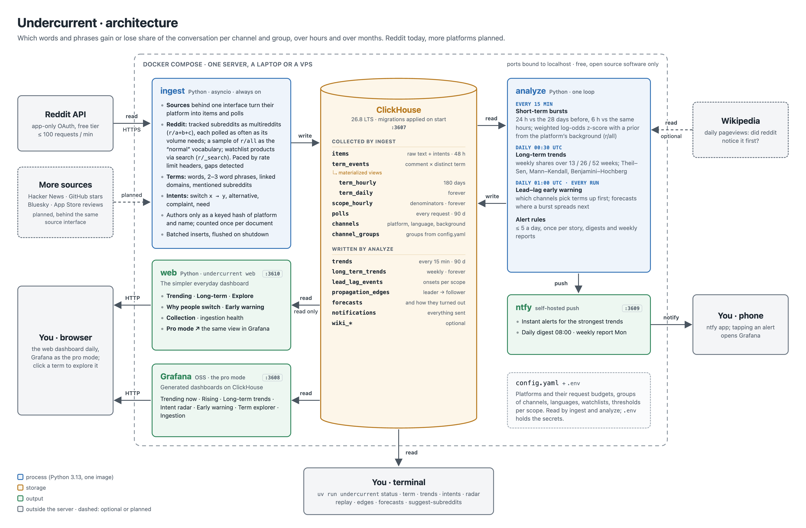

# Word Growth Rate Analyzer

Finds out which words and phrases are gaining or losing share of the conversation in
subreddits and groups of subreddits, over hours (short term) and months (long term).
The design and the roadmap are in [docs/ARCHITECTURE.md](docs/ARCHITECTURE.md).



The diagram is generated from [docs/architecture.html](docs/architecture.html), the command
to render it is at the top of that file.

This is version 2, in Python and ClickHouse. Version 1 (TypeScript, MongoDB and Redis) was
replaced on 2026-10-31 and is in the git history up to commit `eef466c`.

Reddit is the only source so far. Storage, analysis and dashboards count channels
(`r/technology`, the r/all sample `r/all`) and don't know Reddit, so more platforms can
follow: Hacker News, GitHub, Bluesky and app reviews are planned in
[docs/CROSS-PLATFORM.md](docs/CROSS-PLATFORM.md).

Phases 1, 2 and 4, the lead–lag early warning and intents are built. The ingester collects comments
and posts from the subreddits in [config.yaml](config.yaml) into ClickHouse. Every 15
minutes the analyzer scores what is mentioned far more than usual, per subreddit and per
group, stores it for Grafana and sends the strongest trends and a daily digest to your
phone through ntfy. Once a day it also looks for long-term trends, terms that grow or fade
steadily over 13, 26 and 52 weeks, and sends a weekly report. Those need at least 13
complete weeks of history, so collecting should start as early as possible. And it learns
which subreddits pick up terms before others, to forecast which of today's bursts will
reach other subreddits, groups or all of reddit ([Early warning](#early-warning)), which
needs 4–6 weeks of history.

Beyond what is mentioned, it counts why ([Intents](#intents)): people switching from one
product to another or thinking about it, looking for alternatives, complaining, and asking
for tools that don't exist. They can only be extracted while the raw text is kept (48 hours), so they're counted
from the moment the ingester extracts them.

## Cost

Everything runs on free, open source software: ClickHouse, Grafana OSS, ntfy, Python.
Reddit's API is used within its free tier (100 requests per minute, non-commercial use).
No paid APIs. The only cost is the machine it runs on, locally that's your own computer.

## Run it

Requires Docker. Works the same on a laptop and on a server.

1. Create `.env` from the example and fill it in:

   ```bash
   cp .env.example .env
   ```

   * `REDDIT_CLIENT_ID` and `REDDIT_CLIENT_SECRET` of a Reddit "script" app. No Reddit
     username or password needed, and only while `platforms.reddit` is enabled.
   * `AUTHOR_HASH_KEY`, `CLICKHOUSE_PASSWORD` and `GRAFANA_ADMIN_PASSWORD`: generate each
     with `openssl rand -hex 32`. Never change `AUTHOR_HASH_KEY` afterwards.

2. Choose subreddits and groups in `config.yaml`. A group lists channels: a subreddit is
   written `r/technology`.

3. Start ClickHouse, Grafana, the web dashboard, ntfy, the ingester and the analyzer:

   ```bash
   docker compose up -d --build
   ```

4. Open the web dashboard at <http://localhost:3610>. It shows what the Grafana
   dashboards below show, presented more plainly: one row per trending term with where
   else it trends, words instead of statistics' names (a q-value is "very strong",
   "moderate" or "weak", with the number on hover), explanations next to the numbers, and
   any term opens in a side panel with its chart, where it's discussed and the comments
   behind it. Its pages are Trending (and a Quick look, Rising), Long-term, Why people
   switch (Intent radar), Early warning, Explore (Term explorer) and Collection
   (Ingestion). Every view is a link, and "Pro mode" opens the same view in Grafana. Set
   `WEB_PASSWORD` in `.env` to ask for a password.

   Grafana stays as the pro mode, with every panel and setting: open
   <http://localhost:3608>, log in as `admin` with `GRAFANA_ADMIN_PASSWORD`.
   The dashboards are in the WGRA folder:
   * **Trending now**: what the analyzer found, per group and its channels: score,
     times the usual share, mentions, authors, breadth, a sparkline of the last week,
     and the alerts. Click a term to explore it.
   * **Long-term trends**: per group and its channels, the emerging, mainstreaming,
     fading and one-off terms of the last 13, 26 or 52 weeks, with growth per month,
     significance and the weekly share as a sparkline.
   * **Early warning**: which channels lead which (lead time, hit rate, lift, sample
     size, as a table and a graph), recent cascades, the current forecasts and how past
     forecasts turned out.
   * **Intent radar**: the top switching flows (x → y) with the flow the other way and a
     daily sparkline, rising alternatives sought, complaints and switches considered, the
     top needs per group, and the comments behind each of them from the last 48 hours.
   * **Term explorer**: how often terms are mentioned over time, where, and recent
     examples. Per hour, day or week, and for groups pooled or as the average of the
     channels' shares.
   * **Rising (preview)**: a simpler first look at what's mentioned more than usual.
   * **Ingestion**: is the ingester healthy and complete, per platform.

   Every dashboard picks a group or a single channel: `reddit` is every tracked subreddit,
   `r/all` the sample of the rest of reddit.

5. Subscribe to the alerts: open <http://localhost:3609/wgra> in a browser, or see
   [Notifications on your phone](#notifications-on-your-phone). Check that they arrive:

   ```bash
   uv run wgra notify-test
   ```

On a server the ports only listen on localhost. Reach the dashboards through an SSH tunnel:

```bash
ssh -L 3610:localhost:3610 -L 3608:localhost:3608 your-server
```

The ingester and the analyzer keep running (and restart with Docker) until you stop them:

```bash
docker compose stop ingest analyze
```

## Trends and alerts

Every 15 minutes, `wgra analyze` compares, for every channel (each tracked subreddit, and
r/all) and every group,
the share of comments and posts mentioning each term in a window with its share before:

* **24h**: the last 24 hours against the 28 days before.
* **6h**: the last 6 hours against the same 6 hours of the day on the 28 days before, so
  mornings are compared with mornings.

A term is trending with at least 10 mentions by 5 different people, twice its usual
share, and a score (the strength of the evidence, a z-score of the weighted log odds
with a prior from the r/all sample, see the
[architecture](docs/ARCHITECTURE.md#42-short-term-burst-detection)) of at least
3. "pro" isn't shown as trending when "vision pro" explains it. For groups, breadth
counts the channels the term trends in. All of it is in the `detect:` section of
[config.yaml](config.yaml), overridable per scope.

What reaches your phone:

* **Instant alerts**, at most 5 a day: a score of at least 10 with 20 authors, or a
  term trending in many channels of a group at once. A term alerts once per story:
  not again for 72 hours unless its score doubles, and only in the scope where it's
  strongest.
* **A daily digest per group** at 08:00 (Europe/Berlin, set in `notify:`): the 10
  strongest trends of the last 24 hours in the group and its channels.
* Tapping either opens Grafana.

**The first days.** Without history, the window is compared with the share on all of
reddit, so on day one Trending now shows what's distinctive for each group (tech: ai,
code, claude) rather than what's rising. Alerts and digests wait until there are 3 days
of history. The full 28-day reference period takes 4 weeks.

### Tuning without waiting

`wgra replay` runs the detector as of past hours on the stored data and simulates the
alert rules. It writes and sends nothing, so it can run next to the live analyzer:

```bash
uv run wgra replay --from 2026-10-14T00:00 --to 2026-10-21T00:00 --horizon 24h
uv run wgra replay --from 2026-10-14T00:00 --min-z 4 --alert-min-z 8 --csv trends.csv
```

It prints how many alerts each day and group would get, and lists them.

### Notifications on your phone

Install the ntfy app (Android, iOS) and subscribe to the topic `wgra` on your server.
The phone has to reach ntfy and, for the links, Grafana:

* **On a server:** put ntfy (port 3609) and Grafana (3608) behind a reverse proxy with
  TLS, set `NTFY_BASE_URL` and `GRAFANA_URL` in `.env` to their public urls, and protect
  them (ntfy supports [access control](https://docs.ntfy.sh/config/#access-control),
  pass a token as `NTFY_TOKEN`). On iOS, also set
  `NTFY_UPSTREAM_BASE_URL=https://ntfy.sh` for instant delivery (free, only message ids
  pass through ntfy.sh).
* **Without a server of your own:** set `NTFY_URL=https://ntfy.sh` and a long random
  `NTFY_TOPIC`. Free and without an account (up to 250 messages a day, WGRA sends about
  a dozen), but anyone who knows the topic can read it.

## Long-term trends

Once a day after 00:30 UTC, `wgra analyze` looks at weekly shares: per ISO week (Monday
to Sunday, UTC), the comments and posts mentioning a term divided by all of them. The
current week is left out, so the results change on Mondays. For every channel and group,
over the last 13, 26 and 52 weeks:

* Terms mentioned at least 20 times a week on average are tested. ClickHouse fits a
  least squares line through every one's log share and picks the fastest growing and
  fading, at most 100 per scope and window.
* For those: the Theil–Sen slope as growth per month (robust against single spikes), the
  Mann–Kendall test for a steady trend, corrected for testing many terms at once
  (Benjamini–Hochberg over every term tested), and how much of the change comes from
  the two highest weeks.
* Each is **emerging** (significant growth, from at most 1 in 1,000 comments),
  **mainstreaming** (significant growth of a common term), **fading**, **one-off**
  (most of the change is one or two weeks far above the rest) or flat (not stored).
* A group's share is the average of its channels' shares, so a big subreddit doesn't
  drown out the small ones. `group_rate: pooled` divides all mentions by all comments
  instead.

A window runs once there are that many complete weeks of data, so the 13-week window
starts 13 weeks after collection begins, and the 52-week window after a year. Until then
the run reports "insufficient history". Every Monday at 08:00 (`notify:`) each group gets
a report with its fastest emerging, mainstreaming and fading terms. All settings are in
the `long_term:` section of [config.yaml](config.yaml), the statistics are explained in
the [architecture](docs/ARCHITECTURE.md#43-long-term-sustained-trends).

```bash
uv run wgra long-term --once                      # run now, store and print the result
uv run wgra long-term --once --as-of 2027-03-01   # as of a past date: the weeks before it
uv run wgra long-term --once --dry-run            # store nothing
uv run wgra trends --horizon 26w --scope tech     # the stored results
```

`--as-of` replays a past date over the stored data: it analyzes the complete weeks before
that date's week and stores them under that week (runs of the same week replace each
other). `wgra analyze --no-long-term` turns the daily run off, `wgra long-term` without
`--once` runs only the daily long-term loop and the reports.

## Early warning

Some communities pick up terms days before others: a model name in r/LocalLLaMA before
r/technology, a product in a niche subreddit before all of reddit. The analyzer learns
these leader → follower edges from its own trends and turns them into forecasts.

* **Events and onsets.** Every term that trends (score 5 or more) becomes an event. For
  each event, every channel (each tracked subreddit, and r/all, reddit-wide) and every
  group gets an onset: the first hour its last 24 hours mentioned the term at least 5 times,
  twice its usual share, with a score of 3 (the same scoring as trends, against its own
  28 days before). A group a channel belongs to is also measured without it, so "the
  rest of tech follows r/LocalLLaMA" isn't just r/LocalLLaMA's own mentions.
* **Edges**, learned every day after 01:00 UTC from the events of the last 180 days: for
  each leader (a tracked subreddit) and follower, how often the follower crossed within 7
  days after
  the leader (when it hadn't before), after how long (median and IQR), against how often
  it crosses on any trending term (the base rate). A pair is an edge with at least 5
  events and 3 hits, significantly more hits than the base rate explains, and the leader
  significantly more often first than second (at least 70% of the events where both
  crossed): two subreddits that pick up the same big stories in either order are related,
  but neither leads. Both tests are corrected for testing every pair. The probability
  shown is shrunk towards the base rate, with an 80%
  interval, so 3 hits of 3 don't read as a certainty. Per topic too: a channel can lead
  on tech terms and follow on everything else.
* **Forecasts**, after every analysis run: a term trending in a leader whose followers
  haven't crossed yet, with the chance they will (lowered for the time that already
  passed) and when. They're resolved as hits or misses later, and shown in Grafana.
  Alerts for them are **off** (`forecast.alert`) until a replay shows they're worth it;
  switched on they count against the daily alert cap.

Edges need history: an event takes 17 days to be over, and a pair needs several of them.
Expect the first edges after 4–6 weeks of collection, and treat them as hints until
`wgra replay --forecast` says how often forecasts come true. Settings are in the
`lead_lag:` and `forecast:` sections of [config.yaml](config.yaml), the method in the
[architecture](docs/ARCHITECTURE.md#46-lead-lag-early-warning).

```bash
uv run wgra lead-lag --once                 # turn new trends into events, learn the edges
uv run wgra edges --leader r/localllama     # the latest edges
uv run wgra forecasts --pending             # what's expected to spread
uv run wgra forecasts --days 30             # and how earlier forecasts turned out
```

`wgra analyze --no-lead-lag` turns the layer off, `lead_lag.enabled: false` too.

**How good are the forecasts?** `wgra replay --forecast` replays them over stored
history, learning the edges as of each day like the live loop, so nothing it uses comes
from after the forecast. It reports precision (forecasts that came true), recall
(followers that followed and were forecast before they did), the warning time and the
calibration (do 60% forecasts come true 60% of the time). `--events stored` uses the
trends the analyzer stored instead of re-running the detector, which is much faster:

```bash
uv run wgra replay --forecast --events stored --from 2026-11-01 --to 2026-12-01
uv run wgra replay --forecast --events stored --min-events 8 --max-q 0.01
uv run wgra replay --forecast --step 6 --horizon 24h    # re-running the detector
```

**Publishing them** is planned in [docs/FORECAST-LEDGER.md](docs/FORECAST-LEDGER.md): every
forecast in a public ledger the moment it's made, timestamped through OpenTimestamps so it
can't be backdated, and graded when it resolves.

**Which subreddits to add?** `wgra suggest-subreddits` looks at the r/all sample's comments
and posts of the last 48 hours: their urls name the untracked subreddit they come
from. It lists those that mentioned the terms rising now early (before they trended) or
far more than their size explains, as lines to paste into a group of `config.yaml`. It
never changes the config.

**Do the onsets come first?** Optionally (`wikipedia.enabled`, or `wgra wikipedia`),
events whose term names a Wikipedia article are compared with its daily pageviews
(Wikimedia's free API, cached, rate limited): did interest there rise after the event's
first onset? It prints how often the onset was first and a sign test.

## Intents

Every comment and post is also searched for why something is mentioned. Five kinds, each
counted like a word under a term of its own:

| Kind | Term | From, for example |
| --- | --- | --- |
| switch | `notion → obsidian` | "I switched from Notion to Obsidian", "dropped ChatGPT for Claude", "we replaced our Jira with Linear", "the Jenkins to GitHub Actions migration" |
| alternative | `alternative: lastpass` | "any alternatives to LastPass?", "a good Plex alternative", "I use Firefox instead of Chrome" |
| complaint | `complaint: reddit` | "is Reddit down?", "Teams is unusable", "cancelled my Netflix subscription", "Spotify raised prices", "YouTube enshittification" |
| need | `need: track my sleep` | "is there an app to track my sleep?", "I wish there was a way to mute subreddits", "I'd pay for an app that …" |
| considering | `considering: notion → obsidian`, `considering: notion` | "I'm thinking of switching from Notion to Obsidian", "should I switch from Notion to Obsidian?", "thinking about leaving Notion", "about to cancel Notion", "should I ditch Notion?" |

English patterns run everywhere, german ones ("von Windows zu Linux gewechselt", "Alternative
zu Notion", "Gibt es eine App für …") in german subreddits. Precision comes first: a pattern
only counts with the exact wording, and what it's about has to be written like a name
("Notion", "iPhone", "AWS", "gpt-5", or on the lists of known names), so "switched from 2 to 3
monitors", "went from 60 to 144 Hz" and "instead of going outside" count as nothing. A
switch has to have happened; a switch only thought about counts as `considering`, and only
in the first person ("I'm thinking of", "should I"), not as advice ("you could switch") or
after "if", "would" or "could". The price is recall: on the first days about 1 item in 6,000
had an intent. Precision is not where it should be yet: on the first 40 hours of live data
50–79% per kind were judged correct (the target is 80%), mostly because game characters,
countries and languages look like names. Lists of those and stricter cuts ("Figma's
components" isn't Figma) were added since, and haven't been measured yet. Check the comments
behind a surprising intent (the Intent radar links them). How the patterns were tuned and
measured is in the [architecture](docs/ARCHITECTURE.md#47-intents-why-people-mention-things).

Intents go through the same detection as words: a switch trending in a subreddit, a
complaint emerging over months, a need picked up by one community before others. They have
lower gates (3 mentions by 3 people in a day instead of 10 by 5, 2 a week instead of 20 for
long-term trends) and are ranked apart from words, in `config.yaml` (`detect.kind_thresholds`,
`long_term.kind_min_mentions_per_week`, `lead_lag.kind_onset_min_mentions`).

```bash
uv run wgra intents --scope tech                           # all five kinds, last 7 days
uv run wgra intents --scope r/all --kind switch --days 30 --examples 2
uv run wgra term "complaint: reddit" --scope tech --bucket hour --days 2
```

`wgra intents` shows the most mentioned intents of a scope with the number of authors, the
share per 10,000 comments and posts, the change against the days before, whether the
analyzer finds them trending, and with `--examples` the sentences they came from.

**After upgrading the ingester**, count the intents of the items it stored before, once:
their text is still there for up to 48 hours. `--before` is when the new ingester started:

```bash
uv run wgra backfill-intents --before 2026-10-12T09:30 --dry-run
uv run wgra backfill-intents --before 2026-10-12T09:30
```

## Churn radar

Being built, see [docs/CHURN-RADAR.md](docs/CHURN-RADAR.md): a weekly report per product
and its competitors of who leaves which product, for what and why, at no cost. Phases 1
(collection) and 2 (precision and the `considering` kind) run. In `radar:` of
[config.yaml](config.yaml), a watchlist names a category's products and the group of its
subreddits (the pilot: note-taking, `pkm`). For its products the ingester:

* counts their single-word names as names in intents in any case ("switched from evernote
  to obsidian"),
* searches all of reddit for new posts naming them, every 15 minutes per product,
* and fetches, once, the comment tree of a post found that way whose title asks or tells
  about a switch ("Alternatives to Notion?"), a day after it was posted.

What search finds outside the tracked subreddits is counted in the channel `r/_search`. It
isn't a complete stream, so it's in no group and no detector sees it.

The radar only counts intents about a watched product: a switch or a switch considered
with a watched product on either side ("considering: notion → obsidian" counts for both),
an alternative sought to one, a complaint about one. A game character, a country or a
language can't be a watched name, so the most common errors of intents never reach it. To
see how much there is to report on, per product and where it comes from (the watchlist's
subreddits, the other tracked ones, the r/all sample, the search):

```bash
uv run wgra radar candidates --days 1
```

## Command line

Needs [uv](https://docs.astral.sh/uv/). It reads `.env`, so it reaches the ClickHouse
started by Docker Compose.

```bash
uv sync
uv run wgra status
uv run wgra term "claude code" --scope tech --days 14
uv run wgra term rust --scope r/programming --bucket hour --days 2
uv run wgra term ai --scope tech --bucket week --days 180
uv run wgra trends --scope tech                 # the latest trends
uv run wgra trends --horizon 13w                # the latest long-term trends
uv run wgra analyze --once --no-notify          # one analysis run, prints the top trends
uv run wgra long-term --once --dry-run          # one long-term run
uv run wgra lead-lag --once --dry-run           # one lead–lag run, prints the edges
uv run wgra edges && uv run wgra forecasts
uv run wgra suggest-subreddits                  # untracked subreddits worth adding
uv run wgra intents --scope tech --kind switch  # who switches from what to what
uv run wgra radar candidates                    # the churn radar's material per product
uv run wgra wikipedia                           # onsets vs Wikipedia pageviews
uv run wgra notify-test
```

A scope is a group from `config.yaml`, a channel (`r/technology`), `reddit` (every tracked
subreddit) or `r/all` (the r/all sample of everything else). `wgra status` lists every
channel with its platform and what it collected in the last 24 hours.

To run the ingester outside of Docker, stop the container first (both would share one
API budget), then run `uv run wgra ingest` (every enabled platform, or `--source reddit`). The analyzer can run anywhere, but run only
one of it with notifications on, or alerts go out twice.

## How the data is stored

| Table | What | Kept |
| --- | --- | --- |
| `items` | Raw comments and posts, their channel, url, language and the intents found in them, for examples in the dashboards | 48 hours |
| `term_hourly` | Per hour, channel, document type and term: comments mentioning it, occurrences, distinct authors | 180 days |
| `term_daily` | The same per day | forever |
| `scope_hourly` | Per hour, channel and document type: all comments, words and authors (the denominators) | forever |
| `channels`, `channel_groups` | The channels and groups of `config.yaml`, rewritten when the ingester starts | |
| `polls` | Every request to a platform, for the ingestion dashboard | 90 days |
| `trends` | Every 15 minutes, the top 50 trends per scope and horizon (and the top 20 of each intent kind), with the numbers behind them and what happened with the alert | 90 days, alerts forever |
| `long_term_trends` | Every week, the emerging, mainstreaming, fading and one-off terms per scope and window, with the statistics and weekly shares behind them | forever |
| `notifications` | Every message sent to ntfy (alerts, digests, weekly reports, forecast alerts) | forever |
| `lead_lag_events` | Every term that trended, with every scope's onset hour for it | forever |
| `propagation_edges` | Every day, the leader → follower edges with lead time, hit rate, base rate, lift, probability and sample size | 180 days |
| `forecasts` | Every forecast, its probability when made and how it turned out | forever |
| `wiki_articles`, `wiki_pageviews`, `wiki_leads` | Optional: Wikipedia articles of event terms, their daily views, when interest rose there | forever |

* Terms are single words, 2-3 word phrases that don't start or end with a stopword, linked
  domains, mentioned subreddits, and intents (`notion → obsidian`, `complaint: reddit`).
* A comment counts once per term however often it repeats it, and distinct authors are
  counted too, so one spammer can't make a trend.
* Authors are only stored as a keyed hash, never as usernames. Raw text is deleted after
  48 hours, as Reddit asks of API users.
* Tracked subreddits are polled completely as multireddits (`r/a+b+c`), each feed as often
  as its volume needs. A sample of r/all serves as the "normal" vocabulary. Reddit only
  returns its last second or two, so it's a sample of a few percent. What it finds outside
  the tracked subreddits is pooled into one channel, `r/all`. What the churn radar's
  search finds is pooled into `r/_search` the same way.
* Authors are hashed together with their platform, so the same name on two platforms
  counts as two people.

## Development

```bash
uv run pytest            # integration tests need ClickHouse: docker compose up -d clickhouse
uv run ruff check . && uv run ruff format --check . && uv run mypy
```

* While nothing is deployed, schema changes edit the files in `src/wgra/migrations/` in
  place and the local database is recreated (`docker compose down`, `docker volume rm
  wgra_clickhouse_data`, `docker compose up -d --build`), see
  [docs/CROSS-PLATFORM.md](docs/CROSS-PLATFORM.md) §2.2. Once there's history worth
  keeping they go into a new file again, applied on the next start (or with
  `uv run wgra migrate`).
* A new platform is a source in `src/wgra/sources/` (`sources/base.py`: an `Item`, a
  `Sink`, a `Source`), like `sources/reddit/`.
* The dashboards are generated: edit `grafana/build_dashboards.py` and run
  `uv run python grafana/build_dashboards.py`. Grafana reloads them within 10 seconds.
* The web dashboard is `src/wgra/web/`: `queries.py` has the same queries as the Grafana
  panels, as JSON endpoints, so a change to a panel's numbers usually belongs in both.
  The page is plain JavaScript modules in `web/static/` with Preact and htm vendored (one
  file, no build step): edit and reload. `uv run wgra web` serves it on port 3610 from
  the ClickHouse in `.env`.
* `bench/` measures at production scale: `bench/synthetic.py` writes a year of synthetic
  history into a database of its own, `bench/long_term.py` runs the long-term detector
  over it and reports time and memory per query. `bench/lead_lag.py` writes hourly
  history with planted events and measures the lead–lag runs, forecasts and replays. Run
  them against a ClickHouse of their own, never the live one (see the docstrings).
* `bench/intent_names.py` rebuilds the list of words the corpus writes like names from the
  live items, `bench/intent_precision.py` samples intents from them for labeling and scores
  the labels. Both only read; keep the samples, which hold reddit text, out of the
  repository.
