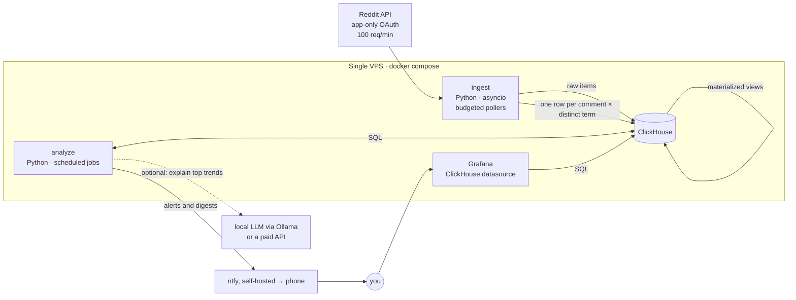

# WGRA v2: Architecture and Plan

Status: phases 1, 2 and 4 and the lead-lag early warning built, collecting history · October 2026

## 1. What the system is for

WGRA answers one question: **which words and phrases are gaining or losing
share of the conversation in a given community, relative to their own normal
level?** It answers it on two horizons:

| Horizon | Question | Example | Delivery |
| --- | --- | --- | --- |
| Short term (hours to days) | What suddenly started being talked about? | "`vision pro` is mentioned in 14x more r/technology comments today than its 28-day norm, by 312 different people" | Push alert, daily digest |
| Long term (weeks to months) | What is steadily growing or fading? | "`local llm` grew about 9% per month in r/programming over the last 26 weeks, with no single spike explaining it" | Weekly report, dashboard |

Both work **per subreddit** and **per topic group**, for example
`tech = r/technology + r/programming + r/hardware + r/LocalLLaMA + …`.

The constraints from the original README still hold. Results must be
normalized for activity swings across the day and week, robust against spam,
cheap enough to run on one small server, and within Reddit's free API tier.

### The gap in v1

v1 can tell you how **a word you already picked** is doing. The `analyzer`
takes a word and returns its growth. The real goal is **discovery**: finding
the trending terms you didn't know to ask about. That means scoring every
term in every scope on every run. It's a bulk aggregation problem, and it
drives most of the decisions below.

## 2. Assessment of v1

| Area | v1 | Problem | v2 answer |
| --- | --- | --- | --- |
| Time resolution | One Mongo doc per (subreddit, word, **day**) | Short-term detection needs hours. Same-day spikes aren't visible until tomorrow. | Hourly buckets, rolled up to daily |
| Long tail | A nightly job deletes every count ≤ threshold | Emerging trends **start** in the long tail (3 → 30 → 300). Deleting it removes the early signal and leaves holes the analyzer has to fill with invented values. | Keep everything. Columnar compression makes it cheap. |
| Normalization | A baseline word (`the`, `die`) per subreddit | A proxy for volume that needs per-language config. The analyzer formula was inverted (fixed in Phase 0). | Divide by the exact number of comments in the scope and bucket |
| Spam | Raw occurrences | One comment repeating "foobar" 500 times looks like a trend | Count **comments containing** the term, and require a minimum number of **distinct authors** |
| Terms | Lowercase ASCII unigrams | Misses `vision pro`, `claude code`, `right to repair`. Broke on non-ASCII (`für` → `fr`) and on newlines (fixed in Phase 0). | Unicode unigrams + bigrams + trigrams, domains, `r/` mentions |
| Sources | New comments only, one request stream per subreddit | Posts carry the highest-signal text (titles). One stream per sub wastes the request budget. | Comments **and** posts, using multireddit streams (`r/a+b+c`) |
| Reddit client | snoowrap (unmaintained), password grant | Needed several workarounds just to run (see Phase 0) | Small client of our own around app-only OAuth |
| Storage | MongoDB + Redis | Mongo is a poor fit for "aggregate billions of rows by term and time". Redis is connected but never used. | ClickHouse |
| Analyzer | One word per run, one query per day, recursive | Can't rank all terms | Set-based SQL over all terms, statistics in Python |
| Product | API and browser UI drawn in the diagram, never built. HookNotifier for push. | Nothing to look at | Grafana dashboards + ntfy push |
| Ops | Kubernetes planned, pm2, Node 12 image | Overkill and outdated | One VPS, Docker Compose, GitHub Actions → GHCR |

## 3. Target architecture



There are three processes and one database, all in one `docker-compose.yml`.
Everything in the solid boxes is free, open source software (see §3.6).

### 3.1 `ingest`

* **Auth:** app-only OAuth (`grant_type=client_credentials`) with the existing
  client ID and secret. No Reddit username or password is needed. The token
  is valid for 24h. Re-authenticate at about 23h, and on a 401.
  **Treat this app as an asset.** Since November 2025, Reddit's Responsible
  Builder Policy requires manual approval for new API apps. Existing apps
  keep working, and this one was verified live on 2026-10-10. Don't delete it
  or create a replacement casually.
* **Streams instead of subreddits.** A stream is one listing URL covering a
  group of subreddits with similar volume: `r/technology+gadgets+hardware/comments`.
  Each returned item carries its own `subreddit`, so attribution is free.
  Low-volume subs get packed together. High-volume subs, and `r/all` as the
  background corpus, get their own stream.
* **Budgeted scheduler.** The free tier allows 1000 requests per 10 minutes
  (the `x-ratelimit-*` headers confirm it). The scheduler spreads that budget
  across streams so that each poll **overlaps** the previous one, which means
  no gaps:
  `interval(stream) ≈ 80 items ÷ observed items-per-second`, bounded by the
  remaining budget. `r/all` gets whatever budget is left and is treated as a
  sample.
* **Measured on 2026-10-10:** the `r/all/comments` listing only reaches back
  about 1–2 seconds. Three polls returned 7, 62 and 0 items, while sitewide
  comment IDs advance at about 60/s (about 5M comments/day). So `r/all` can
  only ever be a sample. A topical multireddit is different: one request for
  `r/technology+programming+news/comments` returned 100 comments spanning
  380s, so polling it every 4–5 minutes captures **everything**. Per-community
  tracking is cheap; only the firehose is out of reach.
* **Gap detection and coverage.** Reddit IDs are base-36 and increase over
  time. If the oldest item in a batch is newer than the newest item from the
  previous poll, there may be a gap. That gets logged to a `coverage` table
  so you can see per stream and hour how complete the data is.
* **Posts too.** Poll `…/new` for submissions (title + selftext) on the same
  streams, at a lower frequency.
* **Cleaning** (in this order): drop `[deleted]`/`[removed]`, AutoModerator,
  known bots and moderator-distinguished comments. Strip quoted lines (`> …`),
  so replies don't count the parent twice. Strip code blocks and markdown
  link targets. Pull out URLs as `domain` terms and `r/xyz` as
  `subreddit` terms. Drop exact-duplicate bodies posted across subs within
  1h (copypasta).
* **Tokenizing:** Unicode-aware, case-folded, with apostrophes kept inside
  words. Unigrams + bigrams + trigrams. An n-gram may not start or end with a
  stopword (per-language stopword lists), so you get `right to repair` but
  not `of the`. Optional light lemmatization with `simplemma` (multilingual,
  so it covers r/de too): `agents` → `agent`.
* **The sample is pooled.** Items from untracked subreddits only arrive through
  the r/all sample, a few percent of each. Per subreddit that's far too thin
  to mean anything. Kept separate, thousands of tiny subreddits would add about
  27 rows per comment, almost all of them counted once (measured: 1,716 sample
  comments came from 1,268 subreddits). So their counts go into one scope,
  `_sample`, with words and two-word phrases only. The permalink still names
  the real subreddit.
* **Output.** One row per (comment, distinct term) goes into a `Null`-engine
  table. Materialized views aggregate those rows, so the raw rows are never
  stored. The raw comment and post text also goes to a table with a **48h
  TTL** (see §7), used for re-tokenizing, examples and explanations.
* **Idempotency.** Persist the last-seen ID per stream so a restart doesn't
  reprocess the last listing. Use `insert_deduplication_token` on batch
  inserts so retries don't double count.

### 3.2 ClickHouse

The schema as built is in
[`v2/src/wgra/migrations/001_init.sql`](../v2/src/wgra/migrations/001_init.sql).

| Table | Engine | Key | Retention | Purpose |
| --- | --- | --- | --- | --- |
| `items` | ReplacingMergeTree | (subreddit, created_at, id) | 48h TTL | Raw comments and posts: example comments, LLM context |
| `term_events` | Null | — | not stored | Insert target, feeds the views |
| `term_hourly` | AggregatingMergeTree | (subreddit, term, kind, source, hour) | 180 days TTL | Short-term detection |
| `term_daily` | AggregatingMergeTree | (subreddit, term, kind, source, day) | forever | Long-term detection |
| `scope_hourly` | AggregatingMergeTree | (subreddit, source, hour) | forever | Denominators: comments, tokens, distinct authors |
| `polls` | MergeTree | (feed, ts) | 90 days | Every request: ingestion health and coverage |
| `subreddit_groups` | MergeTree | (group, subreddit) | rewritten on start | The groups from `config.yaml`, for dashboards and queries |
| `trends` | ReplacingMergeTree | (horizon, scope, term, detected_at) | 90 days, alerts forever | Detector output, alert state |
| `long_term_trends` | ReplacingMergeTree | (horizon, scope, term, week) | forever | Long-term detector output, one set per week |
| `notifications` | MergeTree | (kind, sent_at) | forever | Every message sent to ntfy; makes the daily digest go out once |
| `lead_lag_events` | ReplacingMergeTree | (kind, term, start) | forever | Every term that trended, with every scope's onset (§4.6) |
| `propagation_edges` | ReplacingMergeTree | (day, topic, leader, follower) | 180 days | Leader → follower edges, learned daily |
| `forecasts` | ReplacingMergeTree | (kind, term, event_start, follower, leader) | forever | Forecasts and how they turned out |
| `wiki_articles`, `wiki_pageviews`, `wiki_leads` | ReplacingMergeTree | (project, …) | forever | Optional: Wikipedia articles, daily views, onsets compared |

Each term row carries `occurrences` (sum), `docs` (number of comments
containing the term) and `authors` (`uniqCombined` state, a mergeable
HyperLogLog sketch). Distinct-author counts stay correct when you roll up
hours into days or subreddits into groups. Feed the sketch a **keyed hash**
of the author (HMAC with a secret), never the username, so stored values
can't be linked back to Reddit accounts.

**Sizing, first measurements (2026-10-10, the first minutes of data).**

* A tracked comment adds about 58 term rows before any merging, mostly
  phrases that appear once. A pooled sample comment adds about 10.
* Compressed, a row takes about 15 bytes in these first tiny parts, and fewer
  once parts merge.
* Rows also merge as vocabulary repeats within an hour or a day.

With 37 subreddits (about 130k items/day) plus the sample (about 400k/day),
that points to tens of MB per day for each of `term_hourly` (capped by its
180-day TTL) and `term_daily` (kept forever), so roughly 10–20 GB per year.
Raw text stays around a few hundred MB because of the 48h TTL.

A 4 vCPU / 8 GB / 80–160 GB VPS is enough for years. Check the real daily
growth on the Ingestion dashboard's storage panel after the first full day.
If `term_daily` grows faster than wanted, the lever is a TTL that, after
90 days, drops phrases mentioned only once that day. Single words stay.

### 3.3 `analyze`

The same Python package as `ingest`, with a separate entrypoint (`wgra analyze`)
and a plain loop that runs on the clock (:00, :15, :30, :45):

* every 15 min: short-term burst scoring for all scopes → `trends` → alerts, and
  once a day the digests (built, phase 2)
* daily after 00:30 UTC: long-term scoring on weekly series → `long_term_trends`,
  and a weekly report per group on Mondays (built, phase 4)
* daily after 01:00 UTC: new trends → events and onsets, leader → follower edges →
  `propagation_edges`; after every 15-minute run: forecasts → `forecasts` (built, §4.6)
* hourly: LLM explanation for newly alerted trends (phase 3)

### 3.4 Grafana

Grafana is provisioned from files in the repo, using the official ClickHouse
datasource. None of the dashboards need custom front-end code:

1. **Trending now:** per scope or group, a top-N table with score, ratio,
   authors and a sparkline, linking to the explorer.
2. **Long-term trends** (phase 4): per group and its subreddits, the emerging,
   mainstreaming, fading and one-off terms of the latest week for a 13-, 26- or
   52-week window, with growth per month, q-value, start and end share, spike
   share and the weekly share as a sparkline, linking to the explorer.
3. **Early warning** (§4.6): the leader → follower edges as a table (lead time, hit rate,
   base rate, probability with its interval, lift, n, q) and a node graph, recent
   cascades (every scope's onset in order), the current forecasts, and the track record:
   resolved forecasts, calibration, forecasts per day, and Reddit vs Wikipedia.
4. **Term explorer:** pick terms and scopes, see the relative-frequency time
   series with an auto/hourly/daily/weekly toggle (days and weeks from
   `term_daily`, so beyond the 180 days of `term_hourly`) and a pooled/macro
   group rate toggle, plus example comments.
5. **Ingestion health:** requests/min vs budget, items/min per stream,
   coverage, gaps, error rate. A Grafana alert sends to ntfy when ingestion
   stalls.

A custom web UI is only worth building later, if you want to share this
publicly.

### 3.5 Notifications

ntfy replaces HookNotifier. It's open source and runs as one more container in
the compose file, so there are no message limits and no account. The public
ntfy.sh also works without signup (250 messages/day free). It has an
iOS/Android app and supports click actions, which can open the Grafana
explorer for the term.

There are two notification types:

* **Instant alerts** for very high scores, capped at about 5/day.
* A **daily digest** with the top items per group.

A third, forecast alerts (§4.6), is built but off by default until replays show the
forecasts are worth it; switched on, it shares the cap of 5 a day with trend alerts.

As built (phase 2): ntfy v2.28.0 runs in the compose file on `localhost:3609`.
The analyzer publishes JSON (so terms and titles can be any unicode), with
markdown bodies, a click URL that opens the term in the Grafana term explorer, and
buttons for the explorer and the Trending now dashboard. To reach a phone, put
ntfy behind the same reverse proxy as Grafana (`NTFY_BASE_URL`), or point
`NTFY_URL` at the public ntfy.sh with a long random topic. iOS needs
`NTFY_UPSTREAM_BASE_URL=https://ntfy.sh` for instant delivery, which is free
and only passes message IDs.

The weekly report (phase 4) goes out once per group on Mondays at 08:00 in
`notify.timezone`: the 5 fastest emerging, mainstreaming and fading terms of the
latest week in the group and its subreddits, each term once at its strongest,
linking to the explorer's weekly view and to the Long-term trends dashboard.
Nothing is sent while there are no results (less than 13 weeks of history).

### 3.6 Cost: free apart from the server

| Part | What it costs |
| --- | --- |
| Reddit API | Free tier (100 requests/min). Non-commercial use only, see §7. |
| ClickHouse | Free (Apache 2.0), self-hosted |
| Grafana OSS + ClickHouse plugin | Free (AGPL / Apache 2.0), self-hosted |
| ntfy | Free (Apache 2.0 / GPL), self-hosted |
| Python, uv and all libraries | Free, open source |
| Trend explanations (§4.5) | Optional and off by default. Free with a local model through Ollama; a paid API is an opt-in alternative. |
| Wikipedia pageviews (§4.6) | Optional and off by default. Free, no key: Wikimedia's REST API, with a descriptive user agent and rate limited |
| CI (GitHub Actions), images (GHCR) | Free for public repositories, and within the free minutes for private ones |

The only bill is the server. A small VPS with 4 vCPU, 8 GB RAM and 80–160 GB
disk is enough (Hetzner-class pricing, under 10 €/month). Locally it's
`docker compose up` on your own machine.

## 4. Trend detection

### 4.1 What to measure

For scope `s` (a subreddit or a group), term `w` and time bucket `t`:

* `y` = number of comments in `s` during `t` that contain `w` (`docs`)
* `n` = number of comments in `s` during `t` (from `scope_hourly`)
* `rate = y / n`, the share of comments mentioning the term
* `a` = number of distinct authors who used `w`, used as a spam guard

This replaces both the baseline word and raw occurrences. Dividing by `n`
removes the activity swings across the day and week exactly, with no
per-language baseline word. Counting comments instead of occurrences limits
any single comment to 1. Requiring a minimum `a` limits any single user or
bot.

You don't need to see every comment. Polling is not biased toward particular
words, so a sample estimates `rate` without bias. A smaller sample only
widens the uncertainty, and the scores below use the actual counts, so they
become less confident on their own when data is thin.

### 4.2 Short term: burst detection

Compare a **window** `W` (last 24h, plus a fast 6h variant) with a
**reference** `B` (the 28 days before `W`). Score every term with the
**weighted log-odds ratio with an informative Dirichlet prior** (Monroe,
Colaresi & Quinn, *Fightin' Words*, 2008). It's the standard approach for
"which words are over-represented in corpus A vs B", and it holds up for rare
and brand-new terms. As built
([`v2/src/wgra/detect/scoring.py`](../v2/src/wgra/detect/scoring.py)):

```
π_w   = share of r/all sample comments mentioning w, last 90 days
m_W   = κ · n_W                         # pseudo-documents per side, κ = 0.05
m_B   = κ · n_B + max(n_W − n_B, 0)
α_c   = m_c · π_w + f                   # f = 1, the floor
β_c   = m_c · (1 − π_w) + f
δ_w   = log((y_W + α_W) / (n_W − y_W + β_W))
      − log((y_B + α_B) / (n_B − y_B + β_B))
σ²_w  ≈ 1 / (y_W + α_W) + 1 / (y_B + α_B)
z_w   = δ_w / σ_w
```

The proposal had the paper's form, `α_w = α0 · π_w` added to both sides.
Three changes came out of testing it:

* **Pseudo-counts in proportion to each side's size.** The paper compares
  corpora of similar size. Here `B` is 28 times `W`, and the same pseudo-counts
  pull the small window much harder toward the reddit-wide share than the
  reference. A term that's common on reddit but rare in a subreddit then looks
  like it's rising while nothing changes: a stable term at 0.1% of a scope and
  5% of the sample comes out at 3.2× (z 6.5) with `α0` worth 5% of the window.
  With `α_c ∝ n_c` a term whose share doesn't change scores exactly 0. The prior
  then blends both shares with the reddit-wide share by the same amount. That
  damps bursts of terms that are common everywhere but rare in the scope (likely
  spill-over from elsewhere) and leaves the scope's own vocabulary alone.
* **A floor.** Without it a term absent from the sample and the reference
  period has `α = 0` and an infinite `σ`, so brand-new names could never score.
* **The first day.** While a scope has less history than one window, the
  reddit-wide share stands in for the missing part (`max(n_W − n_B, 0)`
  pseudo-documents). The first day then shows what's distinctive for each scope
  (tech: ai, code, claude; news: trump; gaming: game) instead of nothing. It
  fades out as history comes in. Alerts wait for 3 days of history anyway.

* **Rank** by `z`, the strength of evidence. **Show** `exp(δ)`, the "x times
  more than usual" figure. **Gate** on `y_W ≥ 10`, `a_W ≥ 5`,
  `exp(δ) ≥ 2` and `z ≥ 3`. All thresholds are in `config.yaml`, overridable
  per scope, and get tuned on real data with the replay harness.
* **Stopwords** are never trends as single words (they still bound phrases).
  For a group, only words that are stopwords in every language of its
  subreddits: "war" is German for "was", but not in r/worldnews.
* **New terms:** when `y_B ≈ 0`, the prior keeps the score finite. Flag these
  as `new`, since they're often product or project names.
* **N-gram subsumption:** if `vision pro` is trending, suppress `vision` and
  `pro` when their burst is mostly explained by the bigram. As built: subtract
  the counts of the trending phrases containing the word (only the shortest of
  nested ones, `apple vision pro` is inside `vision pro`'s count) and check the
  gates again. Suppressed rows are kept with `subsumed_by` set.
* **Cooldown:** don't re-alert the same term within 72h unless its score
  doubles. As built, the cooldown is per term across scopes, and a run alerts a
  term once, in its strongest scope: `openai` bursting in r/OpenAI, tech and
  tracked is one story, and the cap is only 5 a day.
* **Breadth:** for a group, count how many member subs show `z > 3` (with at
  least 3 mentions there). A term bursting in 6 of 9 tech subs is a bigger story
  than one sub at `z = 12`. Groups alert on breadth ≥ 3 if that's also ≥ 30% of
  the subreddits mentioning the term: 3 of 31 isn't broad.
* **Hour-of-day effects** in topic mix (for example "breakfast" in the
  morning) matter only for the 6h window. For that window, build `B` from
  the same hours of the day across the last 28 days.
* **Live runs include the current hour**, so a burst shows up within 15
  minutes. Rates stay right because `n` covers the same partial hour.

### 4.3 Long term: sustained trends

As built ([`v2/src/wgra/detect/long_term.py`](../v2/src/wgra/detect/long_term.py)
for the queries and the run,
[`trend_stats.py`](../v2/src/wgra/detect/trend_stats.py) for the statistics), once
a day after 00:30 UTC in `wgra analyze`, or with `wgra long-term --once [--as-of DATE]`:

* **Weekly shares.** ISO weeks, Monday to Sunday UTC. The current, partial week is
  left out, so the results change on Mondays and the other daily runs of a week
  repeat them (rows are keyed by the week, a run replaces its week's rows for the
  scopes it analyzed). Share = comments and posts mentioning the term in the week
  divided by all comments and posts (`scope_hourly`). Weekly shares are computed
  at query time from `term_daily` rather than kept in a weekly table: `term_daily`
  is kept forever anyway, a stored copy would have to be backfilled and kept in
  sync, and both group rates stay available. The weekly shares of every stored
  trend are kept with it (the dashboard's sparklines).
* **Windows of 13, 26 and 52 weeks**, each run once the scope has that many
  complete weeks of history, otherwise reported as "insufficient history: N of 13
  weeks". History counts from a subreddit's first **comment**: the first poll of a
  post listing reaches back hours or days and would make a week look covered.
* **Volume floor:** at least 20 mentions a week on average over the window,
  pooled over a group's subreddits.
* **First pass in ClickHouse** (Appendix C) for every term above the floor:
  `simpleLinearRegression` of the log share over the week index, with 0.5
  pseudo-mentions a week so weeks without a mention have a finite log. The
  candidates: growing or shrinking by at least 5% a month by least squares, the
  100 with the largest |t| per scope and window.
* **Robust statistics in Python**, for the candidates:
  * Theil–Sen slope of the log share, as growth per month `exp(slope × 4.35)`.
    On the test history, a one-week burst at 20 times the usual share makes least
    squares report +34% a month and Theil–Sen +2%.
  * Mann–Kendall two-sided p-value (normal approximation with tie and continuity
    corrections), on the shares: weeks without a mention are ties.
  * **Benjamini–Hochberg over every term the run tested**: all terms above the
    floor in all scopes and windows, the ones that weren't candidates counted with
    p = 1. Correcting over the candidates alone found 105 "trends" in two
    subreddits of pure noise, because the candidates are the most extreme of
    thousands. Counting all found none among 2 million terms of noise. The price:
    with 13 weekly points the smallest possible Mann–Kendall p is 2.6·10⁻⁶, so a
    13-week trend has to be close to perfectly monotonic, unless the same run finds
    many other trends (BH's threshold grows with the number of discoveries).
  * **Spike share:** the change Δ = mean log share of the second half of the
    window minus the first half (the middle week of 13 in neither), and Δ' the same
    without the two highest weeks; spike share = 1 − Δ'/Δ, clipped to [0, 1]. A
    steady trend scores 1/7 over 13 weeks and 1/26 over 52, a burst that fades
    again close to 1, a level that steps up and stays 0.25.
  * **Peak:** the highest week's share divided by the median week's.
* **Classification** (thresholds in the `long_term:` section of `config.yaml`):

  | Category | Rule (defaults) |
  | --- | --- |
  | one-off | spike share ≥ 0.5, peak ≥ 3, and a change of at least 5% a month: a significant trend, or the half-to-half change. Checked first. Without the peak condition, the noise of terms near the floor produced one-offs. |
  | emerging | q ≤ 0.05, Theil–Sen growth ≥ +5% a month, trend line at the start of the window ≤ 1 per 1,000 comments and posts |
  | mainstreaming | the same, starting above 1 per 1,000 |
  | fading | q ≤ 0.05, growth ≤ −4.8% a month (1/1.05) |
  | flat | everything else, not stored |

  Stored: at most 25 per scope, window and category, the fastest growing or
  fading first (one-offs by their change).
* **Storage: a table of its own**, `long_term_trends`
  ([`003_long_term_trends.sql`](../v2/src/wgra/migrations/003_long_term_trends.sql)),
  not more horizons in `trends`. The rows share no statistics with burst rows
  (growth, q, spike share and a weekly series instead of z, ratio, prior and
  breadth). They're kept forever instead of 90 days: at most 13,500 rows a week, and
  what was emerging when is the point. And phase 2's queries over `trends` (the
  digest, the alert cooldown, Trending now) don't tell horizons apart. It follows
  `trends` otherwise: the same scope names and columns where they mean the same,
  `horizon` (13w, 26w, 52w), `rank`, ReplacingMergeTree, created by the
  ingester or the analyzer, whichever starts first.

### 4.4 Scoping by subreddit and topic

```yaml
# config.yaml (replaces config.json)
groups:
  tech:      [technology, programming, hardware, gadgets, LocalLLaMA, MachineLearning, webdev, apple, Android]
  finance:   [investing, stocks, wallstreetbets, personalfinance]
  de:        [de, Finanzen, de_EDV]
subreddits:
  de:        {language: de}
  Finanzen:  {language: de}
background: [all]           # sampled, used for priors and "distinctive terms"
```

* **Group rate:** the macro-average of the member subs' rates by default, so
  r/technology doesn't drown out r/hardware. The pooled rate is available as
  a toggle. As built (phase 4) for long-term trends and the term explorer:
  * a group's weekly share is the average of its subreddits' shares, over the
    subreddits with comments that week; `long_term.group_rate: pooled` divides all
    mentions by all comments and posts instead, and so does the explorer's
    "Group rate: pooled" (its default, like before)
  * a group is analyzed over the subreddits whose history covers the window, if
    at least half of them do. A subreddit added to a group joins the average once
    it has the history; joining at once would shift the average and make its
    vocabulary look like it emerged.
  * the pseudo-mentions are on the pooled scale, 0.5 / all comments of the week:
    0.5 per member subreddit would swamp the small subreddits' shares.
  * on the test history: a term at a constant share in a big subreddit and growing
    fourfold in one 25 times smaller is mainstreaming in the group at +9% a month
    with the macro average, and flat pooled.
  * short-term burst scoring still pools a group's counts.
* **Distinctive vocabulary:** run the same log-odds scoring with *group vs.
  background* instead of *now vs. before*. You get the terms that make a
  community what it is, which is useful for picking topic keywords and for
  explaining what a group cares about.
* **Finding subs for a topic:** start from a hand-picked list. As built,
  `wgra suggest-subreddits` lists untracked subreddits that mention the terms rising now
  early or far more than their size explains, from the r/all sample's raw items (§4.6).

### 4.5 Explaining trends with an LLM (optional)

This step is optional and off by default, because the system has to run for
free. Without it, alerts carry the term, its numbers and links to example
comments, which is often enough.

When it's switched on and something alerts:

1. Pull 20–30 example comments and post titles containing the term in the
   window from the raw tables.
2. Send them, together with the other terms trending in the same scope, to a
   model.
   * **Free:** a small instruct model served by Ollama, either on the server
     (needs a few GB of spare RAM) or on your own machine.
   * **Paid, opt-in:** a hosted API such as Claude.
3. Ask for one or two sentences on *why it's trending*, and for a grouping
   of co-trending terms into one story. For example, `vision`, `pro`,
   `headset` and `apple` become a single story about the headset launch.

Only the handful of daily alerts are sent, never the stream. Raw text is kept
for only 48h (§7). That's enough for short-term alerts. For long-term trends,
fetch fresh examples from Reddit search when generating the explanation. The
explanation goes into the alert and the dashboard.

### 4.6 Lead-lag early warning

As built ([`v2/src/wgra/leadlag/`](../v2/src/wgra/leadlag/)), in `wgra analyze`: the
edges once a day after 01:00 UTC (`lead_lag.run_at`), forecasts after every 15-minute
run. The question: which subreddits pick up terms before other scopes, and so which of
today's bursts will reach other subreddits, groups or reddit as a whole? Detection says
what is rising; this says where it goes next.

**Events.** A term trending in any scope with `z ≥ 5` (`event_min_z`, not subsumed)
starts an event. Its trends within the event's span belong to it, a trend after the span
starts the next event, so "iphone" every September is one event a year. The span runs
from 72 hours before the first trend (a scope can cross the onset gates, which are lower
than the detector's, before anything trends) to 14 days after it (leaders count up to 7
days in, and each gets 7 days for its followers). The trends of an hour are one sighting.
Each event gets a topic: the configured group it trended in most, the group itself or one
of its subreddits with the highest score.

**Onsets.** For every hour of the span, each scope's last 24 hours are scored against its
own 28 days before them with phase 2's weighted log odds (§4.2). `score_arrays` is
`Counts.score` over arrays, tested element by element against it. A scope's onset is the
first hour that passes all of these:

* at least 5 mentions
* at least 2× its usual share
* `z ≥ 3`
* at least 3 days of the scope's own data before the window

That is the hour a detector running then could have seen the term rise in the scope.
There's no author gate: the hourly author sketches can't be summed over rolling windows
cheaply, and the event's trend already passed one. The prior is the term's sample share
over the 90 days before the span, so nothing later goes into it.

The scopes are every tracked subreddit, the r/all sample ("sample", reddit-wide), every
configured group (pooled counts, like short-term detection), and **every group without
each of its subreddits**. Without that last kind, a burst in r/LocalLLaMA would carry
"tech" past the gates on its own mentions, and "r/LocalLLaMA leads tech" would be true by
construction. The question that makes sense is whether the rest of the group follows.

Events are stored with their onsets in `lead_lag_events`, kept forever because `trends`
expires after 90 days. An event's onsets are recomputed daily until its span is over.

**Edges.** Every day, for every leader subreddit L and follower F, over the events of the
last 180 days (`training_days`). The followers are:

* the other tracked subreddits
* the configured groups, without L when L is one of their subreddits
* the sample

For each pair:

| Statistic | Definition |
| --- | --- |
| leader onsets | events where L crossed, up to 7 days after the first trend |
| n (`events`) | of those, the ones F hadn't crossed at or before L, with a known outcome: F crossed since (a hit) or 7 days passed (a miss) |
| hits, hit rate | F crossed within 7 days after L (`max_lag_days`) |
| lead time | median and IQR of the hits' lags, from L's onset to F's |
| base rate b | the share of all closed events (span over, and F collecting by then) in which F crossed at all: how often F picks up a term that trends somewhere |
| probability | the mean of Beta(hits + k·b, misses + k·(1 − b)) with k = 4 pseudo-events (`prior_events`), and its 10th–90th percentile. 3 hits of 3 against b = 0.2 is 54% (27–80%), not 100% |
| lift | probability / b |
| p, q (association) | one-sided binomial test of the hits against b; Benjamini–Hochberg over every pair with n ≥ 5, in every topic |
| reverse, lead share | events where F crossed first, at most 7 days before L; hits / (hits + reverse) |
| direction q | one-sided binomial test of the hits against the reverse at ½; Benjamini–Hochberg over the associated pairs |

A pair is an edge, stored in `propagation_edges` (per day, 180 days), when all of these
hold:

* n ≥ 5 and hits ≥ 3
* both q ≤ 0.05
* lead share ≥ 0.7 (`min_lead_share`)

Edges are learned over all events (topic "all") and per topic, since a subreddit can lead
reddit on tech terms and follow on everything else. Each topic is another look at the same
data, so a topic's edges need q ≤ 0.05 divided by the number of topics.

**Why direction is tested separately.** The first version only tested association, the
hits against the base rate. On the production-scale benchmark it found the 5 planted
leader pairs and about 240 random ones at lift 1.3. The random pairs came from big
events: when a story hits many subreddits, any two of them co-occur, so a leader's onset
makes every follower more likely without anyone leading. Testing whether the leader comes
first among the events where both crossed removes the symmetric pairs: down to 29.

A lead share of at least 0.7 then removes what's left in topic "all" (shares of 0.60–0.66).
These come from volume: a bigger subreddit passes the gates sooner on the same burst.
Dividing `max_q` by the number of topics removes the noise of testing every pair in 6
topics. What remained was 14 edges:

* the 5 planted pairs, with lag medians of 67–73 hours (the planted lags are 48–96 hours)
* 8 of their group and topic versions
* 1 other, a topic edge with n = 56

**Why the topic comes from the first hour.** The first replays were badly calibrated at the
top: forecasts at 75% came true 24% of the time. A topic decided by all of an event's trends
includes the followers' trends. Events the follower picked up got the follower's topic more
often, which made the per-topic hit rates look like 68% where the forecast, knowing only the
leader, could expect 31%. Decided by the first hour, there are no such forecasts, and the
bins are within 8 points of what came true (below).

Three choices behind these definitions:

* The base rate is the share of events with any crossing, not the chance of crossing
  within 7 days of a random time. An event spans 17 days, so lift comes out
  conservative.
* A follower that crossed first doesn't count against a leader, since it couldn't follow.
  When the roles are swapped, it counts for it.
* Correcting over every pair keeps random coincidences out: on the synthetic history, a
  random subreddit's 2 hits of 11 against a base rate of 0.45 are nowhere near an edge.
* The association test is anti-conservative when events differ in size, because a
  leader's onset makes a big event more likely. The direction test and the lead-share
  gate carry the weight, and `wgra replay --forecast` is the arbiter.

**No lookahead.** An onset only uses the hours up to its own. Edges learned as of time T
only count:

* onsets whose hour was over by T,
* misses whose 7 days were over by T,
* base rates from events whose span was over by T,
* events from trends detected by T.

So onsets computed once with all the data agree with those a run at T would have
computed, and replays compute them once. Tested both ways: on hand-built events, and on
the synthetic history, where edges as of day 40 from onsets computed with all the data
equal those from onsets computed with the data up to day 40.

**Forecasts.** After every detection run, for each term trending (`z ≥ 5`) in a
subreddit L that has edges, all of these must hold:

* L's onset in the term's current event is known (its hour is over)
* 7 days haven't passed since it
* F hasn't crossed
* there is an edge L → F with lift ≥ 1.5, the event's topic's edge if there is one,
  else the one over all events

For each such F, the forecast probability is

```
P(F crosses | nothing yet, e hours after L's onset) = p · S(e) / (1 − p + p · S(e))
S(e) = (past hits with a lag above e + 0.5) / (hits + 1)
```

A forecast at 0.3 or more (`forecast.min_probability`) is stored in `forecasts` with:

* its interval (the edge's, adjusted the same way)
* the base rate
* the expected time: the onset plus the median of the past lags still to come
* the due time: the onset plus 7 days

Later runs resolve it: a hit when F crosses by the due time, a miss after. The
probability is the one it was made with and is never updated, so the track record is what
was said when it was said.

Forecast alerts are optional and off by default (`forecast.alert`). Switched on, they
take a forecast at 0.6 or more on an edge with at least 10 events, one per term (its most
likely follower). They count against `notify.max_alerts_per_day` together with trend
alerts, each counting the other's, at most 2 a day.

**Evaluation** (`wgra replay --forecast`). The replay's detector runs (or with
`--events stored`, the stored trends, much faster but with the live settings) give the
sightings of every step. Events come from them, onsets are computed once, edges are
learned once a day as of the first step after `run_at`, and forecasts are made by the same
`decide` as the live loop. Each event and follower is scored once, by its first forecast
(of several leaders the likeliest):

* precision: the share that came true
* recall: of the followers that crossed within 7 days after some subreddit's onset, the
  share forecast before they crossed
* lead time: from the forecast to the follower's onset, for the hits
* calibration: per probability bin, the share that came true, and the Brier score
  against always forecasting the base rate

**Community suggestions** (`wgra suggest-subreddits`). The sample pools every untracked
subreddit, but the raw items (48 hours) still name the real subreddit in their permalink.
For the terms trending now, words and phrases past the detector's warmup, ClickHouse
finds the sampled items mentioning them (words of the text and of the term matched like
the term explorer's examples, one pass with `multiSearchAllPositionsUTF8`).

A subreddit counts for a term only if it over-indexes on it: at least 2 mentions, and 3×
what its share of the sampled items would give it. Without that, r/AskReddit tops every
list. Candidates are ranked by how many terms they mentioned before the terms trended,
how many they mentioned first, then how many in all. The command prints lines to paste
into a group, and never changes the config. On the live data of the first day it takes
0.4 s over 136k sampled items.

**External validation** (optional, `wikipedia.enabled` or `wgra wikipedia`). This checks
whether Reddit onsets lead Wikipedia interest. For closed events whose term names an
article:

* The action API resolves the term, as written and in title case, through redirects.
  "vision pro" becomes Apple Vision Pro. Missing pages and disambiguation pages don't
  count.
* Daily human pageviews come from the Wikimedia REST API: free, no key, a descriptive
  user agent, at most 5 requests a second.
* Articles and views are cached in ClickHouse, so each is fetched once.
* Interest starts on the first day of the span with at least 100 views and 3× the median
  of the 28 days before.
* The lead is that day minus the day of the event's first Reddit onset.

`wgra wikipedia` prints how often Reddit was first, the median lead, and a two-sided sign
test.

## 5. Tech stack

| Concern | v1 | v2 | Why |
| --- | --- | --- | --- |
| Language | TypeScript, Node 12 | **Python 3.13, uv** | The analyzer is the core value. Python has the stats/NLP stack (numpy, scipy, polars, simplemma, LLM clients). Ingest is simple I/O in either language, so one language for both wins. |
| Reddit client | snoowrap (GitHub repo archived 2024-03, deprecated on npm) | **httpx, about 150 lines of our own** | Only two endpoints plus token. You need exact control of rate-limit headers and gap detection. A maintained fallback exists: asyncpraw 8.0.3 (2026-08), which supports read-only mode. |
| Storage | MongoDB 5 (end of life since 2024-10), Redis | **ClickHouse 26.8 LTS** | Built for "group billions of (time, scope, term) rows". Has materialized views, TTL, HyperLogLog states, about 10x compression. |
| Dashboards | none | **Grafana** + ClickHouse datasource | Dashboards and alerting with zero front-end code |
| Push | HookNotifier (still running) | **ntfy, self-hosted** | Free, open source, no limits when self-hosted, click actions |
| Scheduling | node-schedule | A loop in `analyze` | One job every 15 minutes needs no scheduler library |
| Explanations | — | Optional: local model via Ollama (free), or a paid API | Wasn't feasible six years ago |
| Deploy | Kubernetes (planned), pm2 | **Docker Compose on one VPS**, GitHub Actions → GHCR | Right-sized for the job |
| Quality | none | ruff, mypy/pyright, pytest, golden tokenizer tests | — |

Other options considered:

* **Postgres + TimescaleDB:** workable to a few hundred million rows. Ranking
  every term gets slow.
* **DuckDB + Parquet:** excellent for offline work, and the right tool for
  the Phase 4 backfill. But its single-writer model doesn't fit "always
  ingesting while dashboards read".
* **Staying on TypeScript:** viable. The architecture stays the same, only
  the statistics libraries get thinner. Pick it if you'd rather not switch
  languages.

### Repo layout

v2 lives in `v2/` next to v1 until the cutover (phase 5), then moves to the
repository root.

```
v2/
  pyproject.toml, uv.lock   # uv
  config.yaml               # subreddits, groups, languages, budget
  docker-compose.yml        # clickhouse, grafana, ingest (+ ntfy in phase 2)
  Dockerfile
  clickhouse/wgra.xml       # settings for a small server
  grafana/
    build_dashboards.py     # generates dashboards/*.json
    provisioning/           # datasource, dashboard provider
  src/wgra/
    reddit/                 # client: auth, pacing by rate limit headers; listing parsing
    text/                   # cleaning, tokenizer, phrases, stopwords (en, de)
    ingest/                 # feeds + scheduler, processing, batch writer, main loop
    store/                  # clickhouse client, migrations runner
    migrations/*.sql
    query.py                # read-only queries for the CLI
    cli.py                  # wgra ingest | analyze | replay | trends | notify-test | migrate | status | term
    detect/                 # scoring.py, short_term.py, alerts.py, run.py, replay.py,
                            # long_term.py, trend_stats.py
    notify/                 # ntfy.py, messages.py
    leadlag/                # events.py, onsets.py, edges.py, stats.py, forecasts.py,
                            # run.py, evaluate.py, suggest.py, wikipedia.py (§4.6)
    explain/                # phase 3: optional LLM explanations
  tests/
  bench/                    # production-scale synthetic history, long-term and
                            # lead-lag benchmarks
```

## 6. Delivery plan

### Phase 0: get v1 running again (done, see the commit with this document)

* App-only OAuth. **No Reddit password needed.** The token is requested
  directly, because snoowrap's own helper sends it without a User-Agent and
  Reddit answers with a 403.
* Listing `limit` set to 100 (it was 100000). The old value made snoowrap
  paginate about 10 requests per poll, roughly 3x over the free budget for
  r/all alone.
* Tokenizer: split on all whitespace, Unicode letters (`für` stays `für`),
  URLs removed.
* Publisher: `Map` instead of an O(n) array scan per word, plus one
  `bulkWrite` per flush instead of one round-trip per word. Added a compound
  index.
* Analyzer: fixed the inverted normalization (it multiplied by the activity
  change instead of dividing). It now uses the configured baseline per
  subreddit, and there's a CLI: `node dist/index.js <word> [subreddit] [days]`.
* Infra: the Mongo volume was mounted at `/db/data`, so nothing persisted.
  It's now `/data/db`. The init script now works with `mongosh` (needed for
  Mongo ≥ 6). The Dockerfile is on Node 22 + pinned pnpm 7. `.env` is no
  longer baked into the image. `config.json` is mounted in prod.

### Phase 1: foundations (built 2026-10-10, now soaking)

Built, in `v2/`:

* uv project, CI workflow (ruff, mypy, pytest against a real ClickHouse,
  Docker build), migrations runner, compose with ClickHouse, Grafana and the
  ingester.
* Reddit client:
  * app-only token handling
  * pacing from the `x-ratelimit-*` headers, so it also slows down if another
    program uses the same client id
  * multireddit feeds for comments and posts that adapt their own polling
    interval
  * gap detection, cross-feed dedupe, and restart without double counting
  * a startup check that drops unreadable subreddits, because a multireddit
    silently ignores them
* Cleaning and tokenizer with golden tests: umlauts, apostrophes, URLs and
  domains, quotes, code, user mentions, phrase stopword boundaries in English
  and German. Bots, moderator posts and copypasta are skipped.
* Tables and materialized views, including the pooled `_sample` scope (§3.1).
  59 tests, including one proving the views count comments, occurrences and
  distinct authors correctly.
* Grafana, provisioned:
  * **Ingestion**
  * **Term explorer**
  * **Rising (preview)**: the last 24h against a "usual" share that blends the
    term's own last 7 days with its share in the r/all sample. On day one it
    shows what's distinctive for a group (for tech: claude, gpu, ddr4, ryzen,
    prompt, tokens) and it becomes "what's rising" as history accumulates.
* CLI: `wgra status`, `wgra term "<term>" --scope <group|subreddit>`.

Measured in the first hour (Saturday evening, European time):

* 37 tracked subreddits produce about 90 comments/min. Two comment feeds polled
  every 60–90s cover them completely. Posts are slow enough for a 15-minute
  interval.
* An r/all request takes about 3.3s, against about 1.1s for a multireddit.
  So the r/all sample is limited by latency, not budget, to roughly 15–18
  requests/min.
* Total usage is about 20 requests/min of the 100 allowed. There's room for
  many more subreddits.

Still open:

* **Done when:** it runs 72h unattended on the VPS, ≥ 99% of polls succeed,
  there are no gaps in tracked feeds, and storage growth per day is measured
  against the sizing estimate (§3.2).
* Ingestion stall alert (Grafana alert → ntfy). ntfy is now in the compose file.
* Deploying to the VPS (phase 5 automates it; until then
  `git pull && docker compose up -d --build`).

### Phase 2: short-term detection (built 2026-10-10, collecting history)

Built, in `v2/` (see §4.2 for the scoring as built):

* `trends` and `notifications` tables
  ([`002_trends.sql`](../v2/src/wgra/migrations/002_trends.sql)). Every run
  stores the top 50 trends per scope and horizon, with the counts behind the
  score, breadth, subsumption and what happened with the alert. Re-running the
  same time replaces rows. Non-alert rows expire after 90 days.
* Detection for every tracked subreddit (`r/name`) and every group in
  `subreddit_groups`, on two horizons: 24h vs the 28 days before, and 6h vs the
  same 6 hours of the day on the 28 days before. ClickHouse finds the
  candidates in the window (mentions first, then author sketches only for the
  survivors) and counts them in the reference period and the sample. Python
  scores, gates, subsumes and computes breadth. A second small query gets the
  per-subreddit counts for breadth, only for the stored group trends.
* Alerts: at most 5 a day, only for `z ≥ 10` with 20 authors, or broad group
  trends; a 72h cooldown across scopes unless the score doubles; one alert per
  term and run; no alerts before 3 days of history ("warmup").
* `wgra analyze` (every 15 minutes, or `--once`, `--no-notify`), an `analyze`
  service and ntfy v2.28.0 in the compose file. A daily digest per group at
  08:00 Europe/Berlin (configurable) with the 10 strongest trends of the last
  24 hours in the group and its subreddits.
* `wgra replay --from … --to … [--min-z …]`: runs the detector as of past
  hours over stored data, simulates warmup, cooldown and the cap in memory, and
  reports alerts per day and group. Nothing is written or sent, so it can run
  next to the live loop with any settings. `--csv` dumps every trend of every
  step.
* `wgra trends`, `wgra notify-test`.
* Grafana **Trending now**: last run, days of history, the latest trends per
  group and its subreddits with score, times usual, mentions, authors,
  breadth and a 7-day sparkline, linking to the term explorer; the top trends
  over time; the strongest trends of the last 24h (what the digest sends); and
  alerts with their status.
* 107 tests (from 59): the scoring math, gates, subsumption, breadth, alert
  rules, messages and config, plus detection end to end in a throwaway
  ClickHouse database on 29 days of synthetic history (a phrase burst with
  subsumed words, a new term in two subreddits, a stable term, a spammer, a
  daily breakfast pattern for the 6h same-hours reference, alerts, cooldown,
  digests and replay).

Measured on 2026-10-10:

* **Live, first hour of data:** `wgra analyze --once` took 2.6s and wrote 433
  trends in 23 scopes. Without history these are "distinctive vs reddit"
  (tech: ai, code, claude; news: trump; gaming: game), all in warmup, no
  alerts. A test notification arrived through the local ntfy; alert and digest
  payloads (markdown, click URL, buttons) were accepted by it.
* **Production scale, synthetic:** 29 days of 37 subreddits at the measured
  rate (about 120k term rows per hour, 53M rows in `term_hourly` after
  merges), 90 days of sample. One run of both horizons over all 45 scopes:
  **19s, 108 queries, the slowest 2.2s, at most 120 MB per query** (the first
  version needed 1 GB for the tracked group, until breadth got its own
  query). About 1.2 billion rows read per run, mostly from the page cache. The
  Trending now queries take under 200 ms.
* **Noise floor:** on that synthetic data, which has no trends, Poisson noise
  alone reached z ≈ 6 for mid-frequency terms, never the alert threshold of 10.
  Those noise trends rank low on the dashboard; real data is burstier, so
  check the floor again with `wgra replay` once there's history.

Still open:

* **Done when:** about 10 or fewer alerts per day per group at default
  settings, and in a one-week manual review you judge at least 70% of them
  "real". Needs about 4 weeks of data for the full reference period;
  `wgra replay` over the first 1–2 weeks gives the first numbers.
* Tuning `prior_weight`, `alert_min_z` and the gates on real data.
* If runs get slow as `term_hourly` grows: read full days of the reference
  period from `term_daily` (only the 6h horizon needs hours).

### Phase 3: groups and explanations (about 1 week)

* Group config, macro-averaged group rates (built in phase 4 for long-term trends
  and the term explorer), breadth score (built in phase 2), distinctive
  vocabulary.
* LLM explanations and story clustering in alerts and on the dashboard.

### Phase 4: long-term detection (built 2026-10-11, waiting for history)

Built, in `v2/` (see §4.3 and §4.4 for the method as built):

* `long_term_trends`
  ([`003_long_term_trends.sql`](../v2/src/wgra/migrations/003_long_term_trends.sql)),
  the detector and its statistics, the `long_term:` section of `config.yaml`.
* Daily run in `wgra analyze` after 00:30 UTC (`--no-long-term` turns it off). After
  a restart it runs again at the next tick, so the Monday report never has stale
  results. `wgra long-term --once [--as-of DATE] [--dry-run]` runs it on demand, as
  of a past date for replays; without `--once` it's a daily loop of its own.
  `wgra trends --horizon 13w|26w|52w` shows the stored results, `wgra term --bucket
  week` weekly counts.
* Weekly report per group on Mondays at 08:00 (`notify.report_day`, `report_time`,
  `report_size`) through ntfy.
* Grafana: the Long-term trends dashboard; the term explorer got the weekly bucket
  and the pooled/macro group rate. Checked in a throwaway Grafana on demo data.
* 153 tests (from 107): Theil–Sen, Mann–Kendall and Benjamini–Hochberg against
  hand-derived reference values and against scipy (a dev dependency only), spike
  share, peak, classification, config, report message, and end to end in a
  throwaway ClickHouse database on 53 weeks of synthetic history with Poisson
  noise: a term emerging (×50), one mainstreaming (×4), one fading (÷4), a flat
  one, a one-week burst (one-off over 13 and 26 weeks, not a candidate over 52),
  weekend-only and first-of-the-month terms (seasonal: flat), a growing term
  below the floor, macro vs pooled group rates, a subreddit with 19 weeks of
  history, as-of replays, re-runs, the daily schedule and the Monday report.

Measured on 2026-10-11:

* **Live:** `wgra long-term --once` applied migration 003 and reported
  insufficient history for all 45 scopes and windows (the first complete week of
  data starts Monday 2026-10-12, so 13-week results from Monday 2027-01-11). Nothing
  stored.
* **Production scale, synthetic** (`v2/bench/`): 53 weeks of the 37 subreddits at
  about 130k comments a day and the r/all sample at 400k a day, with a Zipf-like
  vocabulary, calibrated to the term rows per hour measured live: 1.03 billion
  `term_daily` rows, 5.7 GiB. On a ClickHouse limited to 4 CPUs and 8 GB (the
  planned VPS), one run of all 45 scopes × 3 windows: **262 s, 135 queries,
  2.0 million terms tested, 7,484 candidates, 0 trends** (the data has none).
  Median query 0.3 s and 39 MiB, 90th percentile 5.6 s and 301 MiB; a subreddit at
  most 6 s and 301 MiB. The expensive ones are the big groups over 52 weeks:
  `tracked` (37 subreddits) 54 s and **750 MiB**, `tech` 33 s and 736 MiB, the
  sample 10 s and 558 MiB. 7.1 billion rows read in all, mostly from the page
  cache.
* What it took to get there, for the next round of tuning: aggregating in the
  order of `term_daily`'s key (subreddit, term, …) instead of hash tables holding
  every term of a year; small blocks (8192 rows), because the parts are read side by
  side (the floor of the biggest subreddit over 52 weeks: 297 → 73 MiB); weekly
  vectors only for terms above the floor, in a second pass (a 52-week subreddit:
  1.3 GiB → 285 MiB); building them from one-hot arrays
  instead of a lambda over (week, count) pairs, which ClickHouse copies for every
  week; one Float32 sum per term and week for groups (1,017 → 750 MiB). Limiting a
  query to 2 threads saves another quarter of memory at twice the time.

Still open:

* **Done when:** 13 weeks of history exist (2027-01-11), and in a review of the
  first reports most emerging and fading terms look real. Tune `min_growth`,
  `max_q`, `emerging_max_base` and the floor then, with `--as-of` replays.
* If the daily run gets in the way: `long_term.exclude_scopes: [tracked]` saves
  about 40% of it (the average over all 37 subreddits is the most expensive and
  the least specific scope). A weekly rollup table filled once per week would cut
  the reads further but needs backfilling and care with group membership changes.
* Distinct authors aren't used yet. A bot posting a term steadily more often
  would look like a trend; the ingester already drops known bots and copypasta.
* Optional, private use only: backfill chosen subs from the Arctic Shift
  monthly dumps (available through 2026-08). Process them with DuckDB and
  write `term_daily` rows marked `source = 'backfill'`. Read the caveats in
  §7 first. That would make long-term results available right away.

### Lead-lag early warning (built 2026-10-11, waiting for history)

Built, in `v2/` (see §4.6 for the method as built):

* `lead_lag_events`, `propagation_edges`, `forecasts`, and the optional Wikipedia cache
  ([`004_lead_lag.sql`](../v2/src/wgra/migrations/004_lead_lag.sql)). The `lead_lag:`,
  `forecast:` and `wikipedia:` sections of `config.yaml`.
* In `wgra analyze`: daily events, onsets and edges after 01:00 UTC (`--no-lead-lag` turns
  it off), and forecasts after every run. Forecast alerts through ntfy are optional and
  off, and inside the daily alert cap.
* CLI:
  * `wgra lead-lag --once [--as-of] [--dry-run]`, `wgra edges`, `wgra forecasts`
  * `wgra replay --forecast [--events stored]` with overrides for the gates
  * `wgra suggest-subreddits`
  * `wgra wikipedia`
* Grafana: the Early warning dashboard, checked in a throwaway Grafana on demo data (the
  synthetic history run through the live loop day by day).
* 208 tests (from 153). They cover:
  * the statistics against scipy, and `score_arrays` against `Counts.score`
  * onsets on arrays, events and topics
  * edges on hand-built events: censoring, eligibility, base rates, direction, no
    lookahead
  * forecasts, their resolution, the alert cap, the evaluation metrics, config and messages
  * `suggest-subreddits` and the Wikipedia check, with a mocked Wikimedia and the
    ClickHouse cache
  * end to end in a throwaway ClickHouse database on 10 weeks of synthetic history: r/a
    leads r/b by 3 days on 18 terms, the sample follows r/a by 5 days on 12 of them, and
    r/c bursts at random on 14 terms (5 of them also in r/b at independent times)

What the synthetic end-to-end test shows, with the detector run daily and then the daily
lead-lag run:

* **r/a → r/b recovered:** 18 hits of 18, lag median 73 hours (IQR 70–75), base rate
  0.45, probability 0.90 (0.81–0.97), q 4·10⁻⁵.
* **The sample follows:** r/a → sample at 119 hours, r/b → sample at 46 hours.
* **Nothing for r/c:** no edge involving it in any topic. Its 2 hits of 11 on r/b against
  a base rate of 0.45 are nowhere near an edge.
* **Replay with daily steps:** precision 87% (13 of 15), recall 23% (the first weeks are
  spent learning), warning median 2.5 days, Brier 0.099 against 0.330 for the base rate
  alone.

Measured on 2026-10-11:

* **Live:** a read-only probe built 132 events from the live trends and computed their
  onsets in 0.1 s. With a day of history no window has 3 days of reference yet, so there
  are no onsets for real. Migration 004 isn't applied to the live database yet; the
  analyzer applies it when it's deployed.
* **Production scale, synthetic** (`v2/bench/lead_lag.py`):
  * The data: 60 days of hourly counts for the 37 subreddits and the sample, calibrated to
    the term rows per hour measured in the first live hour, 245M `term_hourly` rows
    (1.4 GiB). In the last 30 days, 400 events a day of log-uniform rank (a quarter are
    words used every hour in most subreddits), merging into 8,923 events and 626k trend
    rows. Five leaders pass 60% of their terms on to a fixed follower 2–4 days later.
  * The hardware: a ClickHouse limited to 4 CPUs and 8 GB, the planned VPS.

  | Run | Time | Python peak | ClickHouse |
  | --- | --- | --- | --- |
  | first daily run (backfill, 30 days of events) | 55 s | 728 MiB | 156 queries, 34 s in all, slowest 1.3 s, at most 235 MiB, 2.5 billion rows read |
  | daily run (onsets of the 6,423 open events, edges) | 43 s | 945 MiB | 117 queries, 26 s in all, slowest 1.5 s, at most 558 MiB |
  | forecast step of one analyze run (30 leading terms, 300 pending) | 2.4 s | 214 MiB | 21 queries, 1.6 s, at most 113 MiB |
  | learning the edges from 180 days of events (53,538 events, 1.2M onsets) | 3.1 s | 351 MiB | — |
  | `wgra replay --forecast --events stored`, 30 days of hourly steps | 71 s | 782 MiB | 35 s in all, at most 221 MiB |

  * The first live run reads up to 90 days of trends, about 3 minutes at this rate.
  * Most rows read are whole granules of common words, which are in every subreddit every
    hour. Read in chunks of 500 events, one query took 880 MiB; at 250 it's half.
* **Quality on that data:**
  * The 5 planted pairs are found at the right lags, plus 8 of their group and topic
    versions and 1 other edge.
  * Replay: precision 43%, calibrated. Forecasts at 38% came true 46% of the time, at 47%
    came true 42%. The planted followers follow about 40% of their leaders' bursts, the
    rest are random.
  * Brier 0.249 against 0.276, recall on edges 67%, warning median 2.7 days.
  * Overall recall is 2%: most followers in this data follow by chance, and no edge can
    forecast them.

Still open, the limitation that matters: **edges need about 4–6 weeks of real history
before they mean anything.**

* An event takes 17 days to close, and only closed events give base rates.
* A pair needs at least 5 resolved leader onsets, a significant excess over the base rate
  after correcting over thousands of pairs, and the leader first in at least 70% of
  shared events. Topic edges need even more.
* At live rates, the first edges should show up after 3–4 weeks for the most active
  pairs. Precision and calibration numbers from `wgra replay --forecast --events stored`
  start to be worth reading after 6 weeks.
* Until then the dashboard shows few or no edges, and that's the honest answer.

Next:

* Review the first edges and replay numbers (from about 2026-11-15) and tune
  `event_min_z`, `min_events`, `min_lead_share` and `forecast.min_probability`. Turn
  forecast alerts on once calibration holds.
* Turn `wikipedia.enabled` on once there are closed events. It's free, and tells whether
  Reddit leads public interest.
* Consider volume: big subreddits cross sooner on the same relative rise (§7). If the
  edges are mostly big → small, compare onsets at matched mention counts.

### Phase 5: hardening and cutover

* GHCR images, deploy over SSH (`docker compose pull && up -d`), nightly
  ClickHouse `BACKUP` of `term_daily`, `scope_hourly` and `trends` to object
  storage.
* After v2 has 2 weeks of data, stop v1 and drop Mongo and Redis. The v1
  daily counts measure occurrences, not comments, so they aren't comparable.
  Archive them; don't merge them.

## 7. Risks and open questions

Facts below were checked against primary sources on 2026-10-10.

* **Reddit API access.**
  * The free tier is 100 queries/minute per OAuth client, averaged over 10
    minutes. Unauthenticated access is blocked entirely.
  * New apps need manual approval (Responsible Builder Policy, November
    2025), and commercial use needs a contract. Your existing app keeps
    working, so keep the project non-commercial unless you get approval.
* **Deletion obligations.** This is what shapes the design:
  * Reddit's Data API wiki requires removing stored content once it's deleted
    on Reddit, and recommends deleting stored user data within 48 hours.
  * The Data API Terms (revised 2026-07-20) require deleting data your use
    case doesn't need.
  * So: raw text gets a 48h TTL, authors are stored only as keyed hashes
    inside sketches, and long-term storage holds nothing but aggregate
    counts. Whether aggregate word counts are fully outside these rules is a
    grey area, but it's the most defensible design.
* **Research restriction.** Reddit's policy says research using Reddit data
  collected outside its Reddit for Researchers program (academics only)
  violates the policy. A personal trend tool isn't clearly "research", but
  publishing results makes the question harder to avoid.
* **Historical data for backfill.**
  * Pushshift is moderator-only.
  * Arctic Shift has a near-real-time API (no uptime guarantee; slow in
    tests) and monthly dumps through 2026-08.
  * The multi-year bundles have disappeared from Academic Torrents (reason
    unverified). The dumps carry no license.
  * Use only for private exploration, if at all.
* **Coordinated campaigns or bots** can look like trends. Distinct authors
  helps. Account age would help more but costs extra API calls, so it's left
  out for now. A campaign that posts in one subreddit first and others later
  would also look like a lead-lag edge.
* **Lead-lag edges are associations, not causes** (§4.6). Three known biases:
  * Big subreddits pass the onset gates sooner on the same relative rise, since z grows
    with volume. They partly look like leaders for being big. The 2× share gate limits
    this but doesn't remove it.
  * Events are only terms that trended somewhere.
  * The binomial test assumes independent events, while terms of one story are not
    independent.

  Forecasts stay off as alerts until `wgra replay --forecast` shows they're calibrated.
* **r/all is a sample.** It's good for priors and for "what's big
  everywhere". It can't support per-sub conclusions for subs you don't track
  explicitly.
* **Unverified:** the maximum number of subreddits in one `a+b+c` URL. Reddit
  documents no limit for ad-hoc combinations; the practical ceiling is
  probably URL length. Test this in Phase 1, starting at about 50 per stream.

Open questions:

1. Which communities and groups matter first?
2. Is this for you alone (alerts) or eventually public (a site)? That decides
   whether a custom UI and the licensing questions matter.
3. Is Python acceptable, or should v2 stay TypeScript?

## Appendix A: ClickHouse schema

The schema as built is
[`v2/src/wgra/migrations/001_init.sql`](../v2/src/wgra/migrations/001_init.sql).
Changes from the first sketch:

* raw comments and posts share one `items` table with a `source` column
* `source` is part of every term key, so comments and posts can be compared
  or combined
* `uniqCombined(12)` instead of the default precision. That keeps the
  sketch small (about 3 KB at most instead of about 100 KB) at about 1.6%
  error, plenty for author counts.
* every `DateTime` is explicitly UTC

## Appendix B: short-term candidate query

The query as built is `COUNTS_SQL` in
[`v2/src/wgra/detect/short_term.py`](../v2/src/wgra/detect/short_term.py). In
short, per scope and horizon:

```sql
WITH candidates AS (
    -- terms mentioned often enough in the window, then by enough people
    SELECT kind, term FROM term_hourly
    WHERE subreddit IN {subreddits} AND <hour in window>
      AND (kind, term) IN (SELECT kind, term FROM term_hourly
                           WHERE subreddit IN {subreddits} AND <hour in window>
                           GROUP BY kind, term HAVING sum(docs) >= 10)
    GROUP BY kind, term
    HAVING uniqCombinedMerge(12)(authors) >= 5
)
SELECT kind, term,
       sumIf(docs, <hour in window>)                    AS y_w,
       sumIf(docs, <hour in reference>)                 AS y_b,
       uniqCombinedMergeIf(12)(authors, <hour in window>) AS authors_w,
       <their docs in the _sample scope of term_daily, 90 days> AS y_sample
FROM term_hourly
WHERE subreddit IN {subreddits} AND <hour in window or reference>
  AND (kind, term) IN (SELECT kind, term FROM candidates)
GROUP BY kind, term;
-- "in reference" for the 6h horizon: the same hours of the day only.
-- n_W, n_B and the sample's total come from scope_hourly, one query per run.
```

## Appendix C: long-term first pass

The query as built is `FIRST_PASS` in
[`v2/src/wgra/detect/long_term.py`](../v2/src/wgra/detect/long_term.py). Per scope
and window, in short:

```sql
WITH
    above_floor AS (
        -- a subreddit: its terms with min_total mentions. A group of k subreddits: the
        -- terms with min_total / k in one of them (a term above the floor in all of them
        -- together has that much in at least one), then counted exactly in all of them.
        SELECT kind, term FROM term_daily WHERE <the scope's subreddits, the window>
        GROUP BY subreddit, term, kind HAVING sum(docs) >= {member_min}
        ...
    ),
    per_member AS (
        -- the order of term_daily's key: aggregated as the rows stream by
        SELECT subreddit, kind, term,
               sumForEach(arrayMap(w -> if(w = <week of day>, docs, 0), range(weeks))) AS by_week
        FROM term_daily
        WHERE <the scope's subreddits, the window> AND (kind, term) IN above_floor
        GROUP BY subreddit, term, kind
    ),
    series AS (
        -- macro: the members' shares summed per week; pooled: their mentions
        SELECT kind, term, sum(arraySum(by_week)) AS mentions,
               sumForEach(arrayMap((y, n) -> y / n, by_week, totals)) AS weekly_sum
        FROM per_member INNER JOIN member_totals USING subreddit
        GROUP BY kind, term
    )
SELECT kind, term, mentions, shares,
       arrayReduce('simpleLinearRegression', weeks_with_data, log(share + 0.5 / n)).1 AS slope,
       count() OVER () AS tested
FROM series
ORDER BY abs(slope) >= log(min_growth) / 4.35 DESC, abs(t) DESC
LIMIT {max_candidates}
SETTINGS optimize_aggregation_in_order = 1, max_block_size = 8192
```
