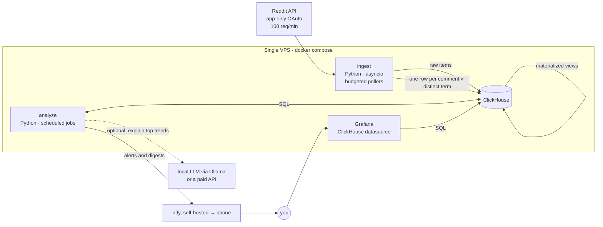

# WGRA v2: Architecture and Plan

Status: proposal · October 2026

## 1. What the system is for

WGRA answers one question: **which words and phrases are gaining or losing
share of the conversation in a given community, relative to their own normal
level?** It answers it on two horizons:

| Horizon | Question | Example | Delivery |
| --- | --- | --- | --- |
| Short term (hours to days) | What suddenly started being talked about? | "`vision pro` is mentioned in 14x more r/technology comments today than its 28-day norm, by 312 different people" | Push alert, daily digest |
| Long term (weeks to months) | What is steadily growing or fading? | "`local llm` grew about 9% per month in r/programming over the last 26 weeks, with no single spike explaining it" | Weekly report, dashboard |

Both work **per subreddit** and **per topic group**, for example
`tech = r/technology + r/programming + r/hardware + r/LocalLLaMA + …`.

The constraints from the original README still hold. Results must be
normalized for activity swings across the day and week, robust against spam,
cheap enough to run on one small server, and within Reddit's free API tier.

### The gap in v1

v1 can tell you how **a word you already picked** is doing. The `analyzer`
takes a word and returns its growth. The real goal is **discovery**: finding
the trending terms you didn't know to ask about. That means scoring every
term in every scope on every run. It's a bulk aggregation problem, and it
drives most of the decisions below.

## 2. Assessment of v1

| Area | v1 | Problem | v2 answer |
| --- | --- | --- | --- |
| Time resolution | One Mongo doc per (subreddit, word, **day**) | Short-term detection needs hours. Same-day spikes aren't visible until tomorrow. | Hourly buckets, rolled up to daily |
| Long tail | A nightly job deletes every count ≤ threshold | Emerging trends **start** in the long tail (3 → 30 → 300). Deleting it removes the early signal and leaves holes the analyzer has to fill with invented values. | Keep everything. Columnar compression makes it cheap. |
| Normalization | A baseline word (`the`, `die`) per subreddit | A proxy for volume that needs per-language config. The analyzer formula was inverted (fixed in Phase 0). | Divide by the exact number of comments in the scope and bucket |
| Spam | Raw occurrences | One comment repeating "foobar" 500 times looks like a trend | Count **comments containing** the term, and require a minimum number of **distinct authors** |
| Terms | Lowercase ASCII unigrams | Misses `vision pro`, `claude code`, `right to repair`. Broke on non-ASCII (`für` → `fr`) and on newlines (fixed in Phase 0). | Unicode unigrams + bigrams + trigrams, domains, `r/` mentions |
| Sources | New comments only, one request stream per subreddit | Posts carry the highest-signal text (titles). One stream per sub wastes the request budget. | Comments **and** posts, using multireddit streams (`r/a+b+c`) |
| Reddit client | snoowrap (unmaintained), password grant | Needed several workarounds just to run (see Phase 0) | Small client of our own around app-only OAuth |
| Storage | MongoDB + Redis | Mongo is a poor fit for "aggregate billions of rows by term and time". Redis is connected but never used. | ClickHouse |
| Analyzer | One word per run, one query per day, recursive | Can't rank all terms | Set-based SQL over all terms, statistics in Python |
| Product | API and browser UI drawn in the diagram, never built. HookNotifier for push. | Nothing to look at | Grafana dashboards + ntfy push |
| Ops | Kubernetes planned, pm2, Node 12 image | Overkill and outdated | One VPS, Docker Compose, GitHub Actions → GHCR |

## 3. Target architecture



There are three processes and one database, all in one `docker-compose.yml`.
Everything in the solid boxes is free, open source software (see §3.6).

### 3.1 `ingest`

* **Auth:** app-only OAuth (`grant_type=client_credentials`) with the existing
  client ID and secret. No Reddit username or password is needed. The token
  is valid for 24h. Re-authenticate at about 23h, and on a 401.
  **Treat this app as an asset.** Since November 2025, Reddit's Responsible
  Builder Policy requires manual approval for new API apps. Existing apps
  keep working, and this one was verified live on 2026-10-10. Don't delete it
  or create a replacement casually.
* **Streams instead of subreddits.** A stream is one listing URL covering a
  group of subreddits with similar volume: `r/technology+gadgets+hardware/comments`.
  Each returned item carries its own `subreddit`, so attribution is free.
  Low-volume subs get packed together. High-volume subs, and `r/all` as the
  background corpus, get their own stream.
* **Budgeted scheduler.** The free tier allows 1000 requests per 10 minutes
  (the `x-ratelimit-*` headers confirm it). The scheduler spreads that budget
  across streams so that each poll **overlaps** the previous one, which means
  no gaps:
  `interval(stream) ≈ 80 items ÷ observed items-per-second`, bounded by the
  remaining budget. `r/all` gets whatever budget is left and is treated as a
  sample.
* **Measured on 2026-10-10:** the `r/all/comments` listing only reaches back
  about 1–2 seconds. Three polls returned 7, 62 and 0 items, while sitewide
  comment IDs advance at about 60/s (about 5M comments/day). So `r/all` can
  only ever be a sample. A topical multireddit is different: one request for
  `r/technology+programming+news/comments` returned 100 comments spanning
  380s, so polling it every 4–5 minutes captures **everything**. Per-community
  tracking is cheap; only the firehose is out of reach.
* **Gap detection and coverage.** Reddit IDs are base-36 and increase over
  time. If the oldest item in a batch is newer than the newest item from the
  previous poll, there may be a gap. That gets logged to a `coverage` table
  so you can see per stream and hour how complete the data is.
* **Posts too.** Poll `…/new` for submissions (title + selftext) on the same
  streams, at a lower frequency.
* **Cleaning** (in this order): drop `[deleted]`/`[removed]`, AutoModerator,
  known bots and moderator-distinguished comments. Strip quoted lines (`> …`),
  so replies don't count the parent twice. Strip code blocks and markdown
  link targets. Pull out URLs as `domain` terms and `r/xyz` as
  `subreddit` terms. Drop exact-duplicate bodies posted across subs within
  1h (copypasta).
* **Tokenizing:** Unicode-aware, case-folded, with apostrophes kept inside
  words. Unigrams + bigrams + trigrams. An n-gram may not start or end with a
  stopword (per-language stopword lists), so you get `right to repair` but
  not `of the`. Optional light lemmatization with `simplemma` (multilingual,
  so it covers r/de too): `agents` → `agent`.
* **The sample is pooled.** Items from untracked subreddits only arrive through
  the r/all sample, a few percent of each. Per subreddit that's far too thin
  to mean anything. Kept separate, thousands of tiny subreddits would add about
  27 rows per comment, almost all of them counted once (measured: 1,716 sample
  comments came from 1,268 subreddits). So their counts go into one scope,
  `_sample`, with words and two-word phrases only. The permalink still names
  the real subreddit.
* **Output.** One row per (comment, distinct term) goes into a `Null`-engine
  table. Materialized views aggregate those rows, so the raw rows are never
  stored. The raw comment and post text also goes to a table with a **48h
  TTL** (see §7), used for re-tokenizing, examples and explanations.
* **Idempotency.** Persist the last-seen ID per stream so a restart doesn't
  reprocess the last listing. Use `insert_deduplication_token` on batch
  inserts so retries don't double count.

### 3.2 ClickHouse

The schema as built is in
[`v2/src/wgra/migrations/001_init.sql`](../v2/src/wgra/migrations/001_init.sql).

| Table | Engine | Key | Retention | Purpose |
| --- | --- | --- | --- | --- |
| `items` | ReplacingMergeTree | (subreddit, created_at, id) | 48h TTL | Raw comments and posts: example comments, LLM context |
| `term_events` | Null | — | not stored | Insert target, feeds the views |
| `term_hourly` | AggregatingMergeTree | (subreddit, term, kind, source, hour) | 180 days TTL | Short-term detection |
| `term_daily` | AggregatingMergeTree | (subreddit, term, kind, source, day) | forever | Long-term detection |
| `scope_hourly` | AggregatingMergeTree | (subreddit, source, hour) | forever | Denominators: comments, tokens, distinct authors |
| `polls` | MergeTree | (feed, ts) | 90 days | Every request: ingestion health and coverage |
| `subreddit_groups` | MergeTree | (group, subreddit) | rewritten on start | The groups from `config.yaml`, for dashboards and queries |
| `trends` (phase 2) | ReplacingMergeTree | (horizon, scope, term, detected_at) | forever | Detector output, alert state |

Each term row carries `occurrences` (sum), `docs` (number of comments
containing the term) and `authors` (`uniqCombined` state, a mergeable
HyperLogLog sketch). Distinct-author counts stay correct when you roll up
hours into days or subreddits into groups. Feed the sketch a **keyed hash**
of the author (HMAC with a secret), never the username, so stored values
can't be linked back to Reddit accounts.

**Sizing, first measurements (2026-10-10, the first minutes of data).**

* A tracked comment adds about 58 term rows before any merging, mostly
  phrases that appear once. A pooled sample comment adds about 10.
* Compressed, a row takes about 15 bytes in these first tiny parts, and fewer
  once parts merge.
* Rows also merge as vocabulary repeats within an hour or a day.

With 37 subreddits (about 130k items/day) plus the sample (about 400k/day),
that points to tens of MB per day for each of `term_hourly` (capped by its
180-day TTL) and `term_daily` (kept forever), so roughly 10–20 GB per year.
Raw text stays around a few hundred MB because of the 48h TTL.

A 4 vCPU / 8 GB / 80–160 GB VPS is enough for years. Check the real daily
growth on the Ingestion dashboard's storage panel after the first full day.
If `term_daily` grows faster than wanted, the lever is a TTL that, after
90 days, drops phrases mentioned only once that day. Single words stay.

### 3.3 `analyze`

The same Python package as `ingest`, with a separate entrypoint and an
in-process scheduler:

* every 15 min: short-term burst scoring for all scopes → `trends` → alerts
* daily: long-term scoring on weekly series → `trends` → weekly report on Mondays
* hourly: LLM explanation for newly alerted trends

### 3.4 Grafana

Grafana is provisioned from files in the repo, using the official ClickHouse
datasource. There are three dashboards, and none of them need custom
front-end code:

1. **Trending now:** per scope or group, a top-N table with score, ratio,
   authors and a sparkline, linking to the explorer.
2. **Term explorer:** pick terms and scopes, see the relative-frequency time
   series with an hourly/daily/weekly toggle, plus example comments.
3. **Ingestion health:** requests/min vs budget, items/min per stream,
   coverage, gaps, error rate. A Grafana alert sends to ntfy when ingestion
   stalls.

A custom web UI is only worth building later, if you want to share this
publicly.

### 3.5 Notifications

ntfy replaces HookNotifier. It's open source and runs as one more container in
the compose file, so there are no message limits and no account. The public
ntfy.sh also works without signup (250 messages/day free). It has an
iOS/Android app and supports click actions, which can open the Grafana
explorer for the term.

There are two notification types:

* **Instant alerts** for very high scores, capped at about 5/day.
* A **daily digest** with the top items per group.

### 3.6 Cost: free apart from the server

| Part | What it costs |
| --- | --- |
| Reddit API | Free tier (100 requests/min). Non-commercial use only, see §7. |
| ClickHouse | Free (Apache 2.0), self-hosted |
| Grafana OSS + ClickHouse plugin | Free (AGPL / Apache 2.0), self-hosted |
| ntfy | Free (Apache 2.0 / GPL), self-hosted |
| Python, uv and all libraries | Free, open source |
| Trend explanations (§4.5) | Optional and off by default. Free with a local model through Ollama; a paid API is an opt-in alternative. |
| CI (GitHub Actions), images (GHCR) | Free for public repositories, and within the free minutes for private ones |

The only bill is the server. A small VPS with 4 vCPU, 8 GB RAM and 80–160 GB
disk is enough (Hetzner-class pricing, under 10 €/month). Locally it's
`docker compose up` on your own machine.

## 4. Trend detection

### 4.1 What to measure

For scope `s` (a subreddit or a group), term `w` and time bucket `t`:

* `y` = number of comments in `s` during `t` that contain `w` (`docs`)
* `n` = number of comments in `s` during `t` (from `scope_hourly`)
* `rate = y / n`, the share of comments mentioning the term
* `a` = number of distinct authors who used `w`, used as a spam guard

This replaces both the baseline word and raw occurrences. Dividing by `n`
removes the activity swings across the day and week exactly, with no
per-language baseline word. Counting comments instead of occurrences limits
any single comment to 1. Requiring a minimum `a` limits any single user or
bot.

You don't need to see every comment. Polling is not biased toward particular
words, so a sample estimates `rate` without bias. A smaller sample only
widens the uncertainty, and the scores below use the actual counts, so they
become less confident on their own when data is thin.

### 4.2 Short term: burst detection

Compare a **window** `W` (last 24h, plus a fast 6h variant) with a
**reference** `B` (the 28 days before `W`). Score every term with the
**weighted log-odds ratio with an informative Dirichlet prior** (Monroe,
Colaresi & Quinn, *Fightin' Words*, 2008). It's the standard approach for
"which words are over-represented in corpus A vs B", and it holds up for rare
and brand-new terms:

```
α_w   = α0 · background_rate(w)        # prior from all scopes, last 90 days
δ_w   = log((y_W + α_w) / (n_W + α0 − y_W − α_w))
      − log((y_B + α_w) / (n_B + α0 − y_B − α_w))
σ²_w  ≈ 1 / (y_W + α_w) + 1 / (y_B + α_w)
z_w   = δ_w / σ_w
```

* **Rank** by `z`, the strength of evidence. **Show** `exp(δ)`, the "x times
  more than usual" figure. **Gate** on `y_W ≥ 10`, `a_W ≥ 5` and
  `exp(δ) ≥ 2`. All thresholds are per-scope config, tuned on real data.
* **New terms:** when `y_B ≈ 0`, the prior keeps the score finite. Flag these
  as `new`, since they're often product or project names.
* **N-gram subsumption:** if `vision pro` is trending, suppress `vision` and
  `pro` when their burst is mostly explained by the bigram.
* **Cooldown:** don't re-alert the same (scope, term) within 72h unless its
  score doubles.
* **Breadth:** for a group, count how many member subs show `z > 3`. A term
  bursting in 6 of 9 tech subs is a bigger story than one sub at `z = 12`.
* **Hour-of-day effects** in topic mix (for example "breakfast" in the
  morning) matter only for the 6h window. For that window, build `B` from
  the same hours of the day across the last 28 days.

### 4.3 Long term: sustained trends

* Aggregate to **weekly** rates. That removes weekday effects and smooths
  noise.
* For every (scope, term) above a volume floor (for example 20 docs/week on
  average), take the last 13, 26 and 52 weeks of `log(rate)` and compute:
  * **Theil–Sen slope**, which is robust to one-off spikes, converted to a
    growth factor per month: `exp(slope × 4.35)`.
  * **Mann–Kendall** test p-value for a monotonic trend, with
    **Benjamini–Hochberg** correction, because you're testing tens of
    thousands of terms at once.
  * **Spike share:** how much of the change comes from the top 1–2 weeks.
    High spike share means "one event", not "trend".
* Classify each term as `emerging` (low base, consistent growth),
  `mainstreaming` (high base, still growing), `fading`, `one-off` or `flat`.
* For speed, do a first pass in SQL (`simpleLinearRegression` over weekly
  log rates for every term) and then run the robust statistics in Python on
  the top few thousand candidates only.
* **History is the bottleneck.** Long-term results need about 8–12 weeks of
  data. Backfilling from historical dumps would shorten that, but it's
  legally grey (§7), so plan around collecting your own history
  (Phase 4).

### 4.4 Scoping by subreddit and topic

```yaml
# config.yaml (replaces config.json)
groups:
  tech:      [technology, programming, hardware, gadgets, LocalLLaMA, MachineLearning, webdev, apple, Android]
  finance:   [investing, stocks, wallstreetbets, personalfinance]
  de:        [de, Finanzen, de_EDV]
subreddits:
  de:        {language: de}
  Finanzen:  {language: de}
background: [all]           # sampled, used for priors and "distinctive terms"
```

* **Group rate:** the macro-average of the member subs' rates by default, so
  r/technology doesn't drown out r/hardware. The pooled rate is available as
  a toggle.
* **Distinctive vocabulary:** run the same log-odds scoring with *group vs.
  background* instead of *now vs. before*. You get the terms that make a
  community what it is, which is useful for picking topic keywords and for
  explaining what a group cares about.
* **Finding subs for a topic:** start from a hand-picked list. Later, suggest
  candidates from subs that show up a lot in `subreddit` terms within a
  group.

### 4.5 Explaining trends with an LLM (optional)

This step is optional and off by default, because the system has to run for
free. Without it, alerts carry the term, its numbers and links to example
comments, which is often enough.

When it's switched on and something alerts:

1. Pull 20–30 example comments and post titles containing the term in the
   window from the raw tables.
2. Send them, together with the other terms trending in the same scope, to a
   model.
   * **Free:** a small instruct model served by Ollama, either on the server
     (needs a few GB of spare RAM) or on your own machine.
   * **Paid, opt-in:** a hosted API such as Claude.
3. Ask for one or two sentences on *why it's trending*, and for a grouping
   of co-trending terms into one story. For example, `vision`, `pro`,
   `headset` and `apple` become a single story about the headset launch.

Only the handful of daily alerts are sent, never the stream. Raw text is kept
for only 48h (§7). That's enough for short-term alerts. For long-term trends,
fetch fresh examples from Reddit search when generating the explanation. The
explanation goes into the alert and the dashboard.

## 5. Tech stack

| Concern | v1 | v2 | Why |
| --- | --- | --- | --- |
| Language | TypeScript, Node 12 | **Python 3.13, uv** | The analyzer is the core value. Python has the stats/NLP stack (numpy, scipy, polars, simplemma, LLM clients). Ingest is simple I/O in either language, so one language for both wins. |
| Reddit client | snoowrap (GitHub repo archived 2024-03, deprecated on npm) | **httpx, about 150 lines of our own** | Only two endpoints plus token. You need exact control of rate-limit headers and gap detection. A maintained fallback exists: asyncpraw 8.0.3 (2026-08), which supports read-only mode. |
| Storage | MongoDB 5 (end of life since 2024-10), Redis | **ClickHouse 26.8 LTS** | Built for "group billions of (time, scope, term) rows". Has materialized views, TTL, HyperLogLog states, about 10x compression. |
| Dashboards | none | **Grafana** + ClickHouse datasource | Dashboards and alerting with zero front-end code |
| Push | HookNotifier (still running) | **ntfy, self-hosted** | Free, open source, no limits when self-hosted, click actions |
| Scheduling | node-schedule | APScheduler in `analyze` | Same idea, in-process |
| Explanations | — | Optional: local model via Ollama (free), or a paid API | Wasn't feasible six years ago |
| Deploy | Kubernetes (planned), pm2 | **Docker Compose on one VPS**, GitHub Actions → GHCR | Right-sized for the job |
| Quality | none | ruff, mypy/pyright, pytest, golden tokenizer tests | — |

Other options considered:

* **Postgres + TimescaleDB:** workable to a few hundred million rows. Ranking
  every term gets slow.
* **DuckDB + Parquet:** excellent for offline work, and the right tool for
  the Phase 4 backfill. But its single-writer model doesn't fit "always
  ingesting while dashboards read".
* **Staying on TypeScript:** viable. The architecture stays the same, only
  the statistics libraries get thinner. Pick it if you'd rather not switch
  languages.

### Repo layout

v2 lives in `v2/` next to v1 until the cutover (phase 5), then moves to the
repository root.

```
v2/
  pyproject.toml, uv.lock   # uv
  config.yaml               # subreddits, groups, languages, budget
  docker-compose.yml        # clickhouse, grafana, ingest (+ ntfy in phase 2)
  Dockerfile
  clickhouse/wgra.xml       # settings for a small server
  grafana/
    build_dashboards.py     # generates dashboards/*.json
    provisioning/           # datasource, dashboard provider
  src/wgra/
    reddit/                 # client: auth, pacing by rate limit headers; listing parsing
    text/                   # cleaning, tokenizer, phrases, stopwords (en, de)
    ingest/                 # feeds + scheduler, processing, batch writer, main loop
    store/                  # clickhouse client, migrations runner
    migrations/*.sql
    query.py                # read-only queries for the CLI
    cli.py                  # wgra ingest | migrate | status | term
    detect/                 # phase 2: short_term.py, long_term.py, scoring.py
    notify/                 # phase 2: ntfy, digests
    explain/                # phase 3: optional LLM explanations
  tests/
```

## 6. Delivery plan

### Phase 0: get v1 running again (done, see the commit with this document)

* App-only OAuth. **No Reddit password needed.** The token is requested
  directly, because snoowrap's own helper sends it without a User-Agent and
  Reddit answers with a 403.
* Listing `limit` set to 100 (it was 100000). The old value made snoowrap
  paginate about 10 requests per poll, roughly 3x over the free budget for
  r/all alone.
* Tokenizer: split on all whitespace, Unicode letters (`für` stays `für`),
  URLs removed.
* Publisher: `Map` instead of an O(n) array scan per word, plus one
  `bulkWrite` per flush instead of one round-trip per word. Added a compound
  index.
* Analyzer: fixed the inverted normalization (it multiplied by the activity
  change instead of dividing). It now uses the configured baseline per
  subreddit, and there's a CLI: `node dist/index.js <word> [subreddit] [days]`.
* Infra: the Mongo volume was mounted at `/db/data`, so nothing persisted.
  It's now `/data/db`. The init script now works with `mongosh` (needed for
  Mongo ≥ 6). The Dockerfile is on Node 22 + pinned pnpm 7. `.env` is no
  longer baked into the image. `config.json` is mounted in prod.

### Phase 1: foundations (built 2026-10-10, now soaking)

Built, in `v2/`:

* uv project, CI workflow (ruff, mypy, pytest against a real ClickHouse,
  Docker build), migrations runner, compose with ClickHouse, Grafana and the
  ingester.
* Reddit client:
  * app-only token handling
  * pacing from the `x-ratelimit-*` headers, so it also slows down if another
    program uses the same client id
  * multireddit feeds for comments and posts that adapt their own polling
    interval
  * gap detection, cross-feed dedupe, and restart without double counting
  * a startup check that drops unreadable subreddits, because a multireddit
    silently ignores them
* Cleaning and tokenizer with golden tests: umlauts, apostrophes, URLs and
  domains, quotes, code, user mentions, phrase stopword boundaries in English
  and German. Bots, moderator posts and copypasta are skipped.
* Tables and materialized views, including the pooled `_sample` scope (§3.1).
  59 tests, including one proving the views count comments, occurrences and
  distinct authors correctly.
* Grafana, provisioned:
  * **Ingestion**
  * **Term explorer**
  * **Rising (preview)**: the last 24h against a "usual" share that blends the
    term's own last 7 days with its share in the r/all sample. On day one it
    shows what's distinctive for a group (for tech: claude, gpu, ddr4, ryzen,
    prompt, tokens) and it becomes "what's rising" as history accumulates.
* CLI: `wgra status`, `wgra term "<term>" --scope <group|subreddit>`.

Measured in the first hour (Saturday evening, European time):

* 37 tracked subreddits produce about 90 comments/min. Two comment feeds polled
  every 60–90s cover them completely. Posts are slow enough for a 15-minute
  interval.
* An r/all request takes about 3.3s, against about 1.1s for a multireddit.
  So the r/all sample is limited by latency, not budget, to roughly 15–18
  requests/min.
* Total usage is about 20 requests/min of the 100 allowed. There's room for
  many more subreddits.

Still open:

* **Done when:** it runs 72h unattended on the VPS, ≥ 99% of polls succeed,
  there are no gaps in tracked feeds, and storage growth per day is measured
  against the sizing estimate (§3.2).
* Ingestion stall alert (Grafana alert → ntfy) together with phase 2's ntfy.
* Deploying to the VPS (phase 5 automates it; until then
  `git pull && docker compose up -d --build`).

### Phase 2: short-term detection (about 1 week)

* Scoring from §4.2 (SQL aggregation, scoring in Python), `trends` table,
  cooldowns, n-gram subsumption.
* ntfy alerts and daily digest. "Trending now" and "Term explorer"
  dashboards.
* Replay harness: re-run detection over stored history with different
  thresholds, so tuning doesn't require waiting.
* **Done when:** about 10 or fewer alerts per day per group at default
  settings, and in a one-week manual review you judge at least 70% of them
  "real".

### Phase 3: groups and explanations (about 1 week)

* Group config, macro-averaged group rates, breadth score, distinctive
  vocabulary.
* LLM explanations and story clustering in alerts and on the dashboard.

### Phase 4: long-term detection and backfill (code in about 1 week; useful once history exists)

* Weekly rollups, Theil–Sen, Mann–Kendall, FDR, classification. Monday
  report per group.
* Optional, private use only: backfill chosen subs from the Arctic Shift
  monthly dumps (available through 2026-08). Process them with DuckDB and
  write `term_daily` rows marked `source = 'backfill'`. Read the caveats in
  §7 first.

### Phase 5: hardening and cutover

* GHCR images, deploy over SSH (`docker compose pull && up -d`), nightly
  ClickHouse `BACKUP` of `term_daily`, `scope_hourly` and `trends` to object
  storage.
* After v2 has 2 weeks of data, stop v1 and drop Mongo and Redis. The v1
  daily counts measure occurrences, not comments, so they aren't comparable.
  Archive them; don't merge them.

## 7. Risks and open questions

Facts below were checked against primary sources on 2026-10-10.

* **Reddit API access.**
  * The free tier is 100 queries/minute per OAuth client, averaged over 10
    minutes. Unauthenticated access is blocked entirely.
  * New apps need manual approval (Responsible Builder Policy, November
    2025), and commercial use needs a contract. Your existing app keeps
    working, so keep the project non-commercial unless you get approval.
* **Deletion obligations.** This is what shapes the design:
  * Reddit's Data API wiki requires removing stored content once it's deleted
    on Reddit, and recommends deleting stored user data within 48 hours.
  * The Data API Terms (revised 2026-07-20) require deleting data your use
    case doesn't need.
  * So: raw text gets a 48h TTL, authors are stored only as keyed hashes
    inside sketches, and long-term storage holds nothing but aggregate
    counts. Whether aggregate word counts are fully outside these rules is a
    grey area, but it's the most defensible design.
* **Research restriction.** Reddit's policy says research using Reddit data
  collected outside its Reddit for Researchers program (academics only)
  violates the policy. A personal trend tool isn't clearly "research", but
  publishing results makes the question harder to avoid.
* **Historical data for backfill.**
  * Pushshift is moderator-only.
  * Arctic Shift has a near-real-time API (no uptime guarantee; slow in
    tests) and monthly dumps through 2026-08.
  * The multi-year bundles have disappeared from Academic Torrents (reason
    unverified). The dumps carry no license.
  * Use only for private exploration, if at all.
* **Coordinated campaigns or bots** can look like trends. Distinct authors
  helps. Account age would help more but costs extra API calls, so it's left
  out for now.
* **r/all is a sample.** It's good for priors and for "what's big
  everywhere". It can't support per-sub conclusions for subs you don't track
  explicitly.
* **Unverified:** the maximum number of subreddits in one `a+b+c` URL. Reddit
  documents no limit for ad-hoc combinations; the practical ceiling is
  probably URL length. Test this in Phase 1, starting at about 50 per stream.

Open questions:

1. Which communities and groups matter first?
2. Is this for you alone (alerts) or eventually public (a site)? That decides
   whether a custom UI and the licensing questions matter.
3. Is Python acceptable, or should v2 stay TypeScript?

## Appendix A: ClickHouse schema

The schema as built is
[`v2/src/wgra/migrations/001_init.sql`](../v2/src/wgra/migrations/001_init.sql).
Changes from the first sketch:

* raw comments and posts share one `items` table with a `source` column
* `source` is part of every term key, so comments and posts can be compared
  or combined
* `uniqCombined(12)` instead of the default precision. That keeps the
  sketch small (about 3 KB at most instead of about 100 KB) at about 1.6%
  error, plenty for author counts.
* every `DateTime` is explicitly UTC

## Appendix B: short-term candidate query

```sql
-- window = last 24h, reference = 28 days before that, one scope
WITH now() - INTERVAL 24 HOUR AS w_start,
     w_start - INTERVAL 28 DAY AS b_start
SELECT
    kind, term,
    sumIf(docs, hour >= w_start)                    AS y_w,
    sumIf(docs, hour <  w_start)                    AS y_b,
    uniqCombinedMergeIf(12)(authors, hour >= w_start) AS authors_w
FROM term_hourly
WHERE subreddit = {scope:String} AND hour >= b_start
GROUP BY kind, term
HAVING y_w >= 10 AND authors_w >= 5;
-- n_w / n_b come from scope_hourly; α_w from a 90-day background table.
-- The log-odds z-score (§4.2) is computed in Python on this candidate set.
```
