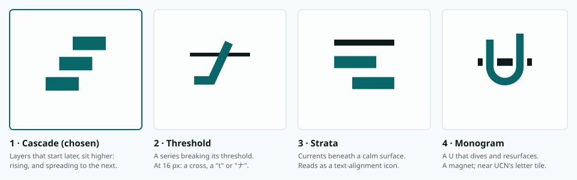

# Undercurrent brand

**Status: accepted 2026-11-01**, with the recommended choices of §10. The logo, colour,
type, tokens and rules for Undercurrent (formerly WGRA, [RENAME.md](RENAME.md)). The files
are in [docs/brand/](brand/); the visual specimen, with every component and application in
light and dark, is the design system
[Undercurrent](https://claude.ai/artifact/XdBgHXdtVmjp7cWhMKayeH) (private until shared).
It replaces the dataviz reference palette and the system sans that
[WEB-DASHBOARD.md](WEB-DASHBOARD.md) §4.5 and §8.1 first named; the dashboard rebuild
applies it (§11).

## 1. Positioning and personality

Undercurrent finds what is rising in online conversation, where it starts, where it spreads
next, and why people switch products. It's read by analysts, product and strategy teams who
make decisions with it, so the brand behaves like an instrument, not a feed.

* **Descriptor:** "Early signals in online conversation." The long form, for the README and
  `pyproject.toml`: "What's rising in online conversation, where it starts, where it spreads
  next, and why people switch products."
* **Personality:** exact, calm, candid, dense. It states what it measured, how sure it is,
  and what it can't know yet. It never shouts, never sells, never decorates.
* **Not:** a growth-hacking dashboard, a social-listening ad, an alarm. Rising is not good
  news and fading is not bad news; the brand describes direction and never judges it.

Serious data and intelligence products (financial terminals, newsrooms' data desks, research
and analytics platforms) present themselves in a recognisable way, and Undercurrent takes the
traits, not anyone's look: neutral screens with one accent colour; one sans family for
interface and numbers, with tabular figures; hairlines instead of shadows; small radii; a
symbol that is a simple geometric figure; numbers that always carry their unit, comparison
and source; a serif only where people read at length. No illustrations, gradients, glow,
mascots or emoji.

## 2. Voice and tone

The voice is the README's and the alerts': plain, precise, no hype.

| Do | Don't |
| --- | --- |
| "12× its usual share: 1,284 comments and posts by 312 people in the last 24h." | "🔥 claude code is exploding!" |
| "very strong" (q 0.0004 on hover) | "z = 9.4, q = 0.0004" as the headline |
| "Chance this time: 58% (41–73%), against 12% for any trending term." | "Likely to go viral" |
| "Long-term trends from Monday 1 February 2027, after 13 complete weeks." | "No data available." |
| "9 of 14" | "64%" (below 10, counts stay counts) |
| "Export CSV", "Open term page" | "Click here", "Get insights" |
| "Collection is 2 hours behind. Reddit returned 429 for r/all since 13:10 UTC." | "Oops! Something went wrong." |

* Numbers first, with their meaning; statistics' names last or on hover.
* Every count of mentions has its number of people beside it.
* Say what's uncertain: intervals, base rates, sample sizes, warm-up periods.
* Sentence case everywhere, titles and buttons included. Verbs on buttons. No exclamation
  marks, no emoji, no "insights", "unlock", "supercharge", "AI-powered", "real-time".
* Terms are quoted as the detector stores them (`claude code`, `notion → obsidian`);
  products keep their own case in prose (Notion, Obsidian).

## 3. The name, and who else uses it

Checked on 2026-11-01:

* **Undercurrent (UCN), formerly Undercurrent News**, a seafood market intelligence service
  and price reporting agency, renamed itself "Undercurrent" in February 2026. It is the
  closest case: another *intelligence* product with the same name. Its look: a lowercase
  geometric-sans wordmark "undercurrent" next to a rounded tile with "ucn" in it, navy
  (`#0C2B41`) in its site header, uppercase tracked taglines ("SEAFOOD PRICES | NEWS |
  DATA"), and photographs of water. It has no wave or water symbol.
* Undercurrent, a New York digital strategy consultancy (2007, closed); an organisational
  design consultancy at undercurrent.org; Undercurrents, a UK video news network; a dance
  company. Different fields, no shared look.

How this brand stays clear of UCN: a title-case grotesk wordmark, not lowercase geometric; a
symbol, never letters in a tile; Current teal and a near-black ink, never navy; no water,
waves or photographs; never abbreviated to UC or UCN as a mark (the `uc` command stays a
command). Before any commercial use, a trademark search (RENAME.md §4) should cover classes
9, 35 and 42.

## 4. Logo



### 4.1 Concepts

1. **Cascade (chosen).** Three bars, each starting later and sitting higher: a term rising in
   one community, then the next, then reaching the surface. It's also the shape of the
   product's own cascade view (onsets in order) and of a rising series. Solid shapes, so it
   holds at 16 px, in one colour, and as an app icon.
2. **Threshold.** A thin reference line and a heavier line rising through it: a series
   crossing its threshold, which is what the detector finds. Exact, but at 32 px and below
   the crossing reads as a plus sign, a "t" or the katakana ナ, and with an end dot it reads
   as a joystick.
3. **Strata.** A thin surface line over two offset bars: currents moving beneath a calm
   surface. Calm and ownable in colour, but in one colour it reads as a text-alignment icon.
4. **Monogram.** A U that dives below a surface line and comes back up. A letter mark reads
   as a magnet and would sit next to UCN's letter tile.

### 4.2 The mark

* **Symbol:** on a 24-unit grid, three bars of 11 × 4.5 units, each 4.5 units to the right
  and 6.75 units above the one before (bars at x 2, 6.5, 11 and y 16.5, 9.75, 3). Square
  corners. The grid's 2-unit margin is part of the symbol file.
* **Wordmark:** "Undercurrent" in IBM Plex Sans SemiBold, tracking −10/1000 em, outlined
  (no font needed to render it).
* **Lockup:** the symbol's bars are 1.07× the wordmark's cap height and centred on it; the
  gap from the bars to the U is 0.46 cap heights.
* **Colours:** symbol Current (`#096669`), wordmark Ink (`#0d191c`) on light; symbol
  `#54bfc3`, wordmark `#edf1f2` on dark and on Ink. One colour: all Ink, or all white on
  Current. The app icon's bars step from `#0e8185` to `#b2e8e9`, lighter toward the
  surface, on an Ink tile.
* **Clear space:** the wordmark's x-height on every side. **Minimum size:** lockup 96 px
  wide, symbol 12 px. Below 16 px use the favicon's pixel drawing.

### 4.3 Files

| File | Use |
| --- | --- |
| `undercurrent-lockup.svg`, `-on-dark.svg`, `-ink.svg`, `-white.svg` | The lockup on light, on dark, one colour |
| `undercurrent-symbol.svg`, `-on-dark.svg`, `-ink.svg`, `-white.svg` | The symbol alone: phone app bar, avatars |
| `undercurrent-wordmark.svg`, `-white.svg` | The name alone, where the symbol already appears |
| `favicon.svg` | 16 px pixel drawing; switches to the dark ink with the browser's theme |
| `app-icon.svg`, `app-icon-512.png` | Home screen, web app manifest |
| `app-icon-maskable.svg`, `app-icon-maskable-512.png` | Manifest `purpose: maskable` (Android crops it) |
| `apple-touch-icon.png` | 180 px, full bleed |
| `notification-icon.png` | 256 px, ntfy's `Icon` header |
| `readme-header.svg`, `readme-header-dark.svg` | README and docs header |
| `logo-concepts.svg` | The concepts above; not for use |

In a page that switches themes, inline the SVG and colour it with the tokens (the specimen's
Logo component uses `uc-logo-sym` with `primary` and `uc-logo-word` with `ink`).

## 5. Colour

### 5.1 The brand colours

| Name | Hex | Where |
| --- | --- | --- |
| Ink | `#0d191c` | The wordmark, text, dark brand surfaces (report covers, the app icon tile) |
| Current | `#096669` (`#54bfc3` on dark) | The symbol, the primary action, links, the selected item |
| Paper | `#f7fafa` | Light brand surfaces, the app's page background |

Current is a deep teal: calm, precise, and away from the navy and blue that most analytics
products and UCN use. Everything else is neutral.

### 5.2 Scales

All three were built in OKLCH (Current at hue 198, the neutrals at hue 214 with chroma
0.002–0.018 so greys lean toward Current, Rust at hue 45), then checked.

| Step | Current | Neutral | Rust |
| --- | --- | --- | --- |
| 0 | | `#fcfefe` | |
| 25 | | `#f7fafa` | |
| 50 | `#ebfafb` | `#f2f5f6` | |
| 100 | `#d5f4f4` | `#e9eeef` | `#fee7dd` |
| 150 | | `#dfe5e7` | |
| 200 | `#b2e8e9` | `#d3dadc` | |
| 300 | `#84d6d8` | `#b7bfc2` | `#f8b495` |
| 400 | `#54bfc3` | `#909a9d` | |
| 450 | | `#818b8e` | |
| 500 | `#17a1a5` | `#6d787b` | `#cd7146` |
| 600 | `#0e8185` | `#515d60` | |
| 700 | `#096669` | `#3d494c` | `#8e3f14` |
| 800 | `#054f51` | `#2d383a` | |
| 850 | | `#242d30` | |
| 875 | | `#1f282a` | |
| 900 | `#033b3d` | `#1b2325` | `#56250d` |
| 925 | | `#151d1f` | |
| 950 | `#032a2b` | `#101719` | |
| 1000 | | `#0c1213` | |

Rust is only the warm arm of diverging scales.

### 5.3 Semantic tokens

Components use these, never the scales. Full list with usage notes in
[brand/tokens.json](brand/tokens.json).

| Token | Light | Dark | For |
| --- | --- | --- | --- |
| `bg` | `#f7fafa` | `#0c1213` | The page |
| `surface` | `#fcfefe` | `#101719` | Panels, tables, charts |
| `surface-sunken` | `#f2f5f6` | `#151d1f` | Table headers, wells, code |
| `surface-raised` | `#fcfefe` | `#1b2325` | Popovers, menus, tooltips (with shadow) |
| `surface-hover` | `#e9eeef` | `#1f282a` | Row and item hover |
| `border` | `#d3dadc` | `#242d30` | Hairlines |
| `border-strong` | `#818b8e` | `#6d787b` | Input and control outlines |
| `ink` | `#0d191c` | `#edf1f2` | Primary text and numbers |
| `ink-secondary` | `#3d494c` | `#d3dadc` | The rest of a row, secondary text |
| `ink-muted` | `#515d60` | `#909a9d` | Help, captions, axis labels |
| `primary` | `#096669` | `#54bfc3` | Primary button, links, selection |
| `on-primary` | `#ffffff` | `#0c1213` | Text on `primary` |
| `primary-wash` / `primary-ink` | `#ebfafb` / `#096669` | `#092e2f` / `#84d6d8` | Current nav item, selected row |
| `focus-ring` | `#0e8185` | `#54bfc3` | 2 px outline, 2 px offset |

**Contrast, checked for every pair a component uses** (WCAG 2): text tokens on `bg`,
`surface`, `surface-sunken`, `surface-raised`, `surface-hover` and the washes are at least
5.03:1 in light and 5.23:1 in dark (AA asks 4.5). `border-strong` is 3.19:1 or more and the
focus ring 4.26:1 or more on every light surface (7.32:1 on dark), above the 3:1 for
controls.

### 5.4 Status

The system's state only (collection, alerts, health), never a term or a series, and always
with an icon and a word.

| | Fill (both themes) | Text light / dark | Wash light / dark | Icon |
| --- | --- | --- | --- | --- |
| good | `#0ca30c` | `#18781a` / `#4cc14a` | `#e9f6e7` / `#122a14` | circle-check |
| warning | `#fab219` | `#8a5a00` / `#f4b73a` | `#fdf3dc` / `#2e2410` | triangle-alert |
| serious | `#ec835a` | `#a8471d` / `#f09a76` | `#fcece4` / `#2f1d15` | octagon-alert |
| critical | `#d03b3b` | `#b42d2d` / `#f07272` | `#fbe9e8` / `#311819` | circle-x |

The fills are the dataviz method's status steps; the text steps hold 5:1 or more on
`surface`, `surface-sunken` and their wash.

### 5.5 Data visualisation

Built with the dataviz method (`validate_palette.js`): candidate OKLCH steps for eight hue
families in each theme's lightness band, a search over orders and steps that maximises the
worst adjacent colour-blind separation, then the steps tuned by eye and every check run again.

| Slot | Hue | Light | Dark |
| --- | --- | --- | --- |
| 1 | teal | `#15a0a1` | `#19a8a8` |
| 2 | rust | `#b24b0a` | `#c4570f` |
| 3 | violet | `#8e65d4` | `#9672e0` |
| 4 | amber | `#b07d00` | `#b08200` |
| 5 | magenta | `#e267a3` | `#d9619e` |
| 6 | green | `#23851b` | `#2f8f25` |
| 7 | blue | `#2d72d3` | `#4a86e8` |
| 8 | red | `#c24242` | `#d75656` |

Validator results on the chart surface (`#fcfefe` light, `#101719` dark):

| Check | Light | Dark | Gate |
| --- | --- | --- | --- |
| Lightness band, chroma floor | pass | pass | |
| Worst adjacent pair, protanopia/deuteranopia (ΔE) | 14.8 | 13.9 | ≥ 8 target, 6 floor |
| Worst adjacent pair, normal vision (ΔE) | 21.4 | 21.6 | ≥ 15 |
| Contrast of every slot against the surface | ≥ 3.10:1 | ≥ 4.07:1 | ≥ 3:1 |
| First three, all pairs (CVD / normal) | 12.0 / 21.9 | 11.5 / 21.5 | ≥ 8 / ≥ 15 |
| First four, all pairs | fails (amber–rust) | fails (amber–rust) | |

For comparison, the reference palette the dashboard uses today reaches 9.1 and 8.4 on the
adjacent CVD check and leaves three slots under 3:1 in light mode.

* Teal is first because it's the brand; rust second because teal against rust is the most
  distinct pair for the most common chart, two series.
* Assign slots in order of first appearance on the page, keep them when a filter removes a
  series, and fold a ninth series into "Other".
* Scatter plots, maps and small multiples coloured by series take at most three colours (the
  first three pass the all-pairs checks; amber and rust don't).
* **Sequential:** `seq-100` … `seq-900`, Current from light to dark; in dark the steps flip so
  near-zero stays near the surface. As an ordinal ramp, start at step 500 on light (3.11:1)
  and stop at 600 on dark (3.88:1); both pass the ordinal checks.
* **Diverging:** `div-neg-3` … `div-pos-3`, rust below, gray at no change (`div-mid`),
  Current above. For signed values: net switching flow, lift against the base rate.
* Chart chrome: `chart-grid` hairlines, `chart-axis` baseline, `chart-label` (= `ink-muted`),
  `chart-crosshair`, `chart-threshold` (dashed), `chart-band` for annotation windows.
* Any change to these values re-runs the validator in both themes, adjacent and first-three
  all-pairs, and updates this table.

## 6. Typography

| Role | Family | Licence | Self-hosted from |
| --- | --- | --- | --- |
| Interface, numbers | IBM Plex Sans (variable) | SIL OFL 1.1 | `@fontsource-variable/ibm-plex-sans` 5.3.0 |
| Commands, config keys, raw terms | IBM Plex Mono | SIL OFL 1.1 | `@fontsource/ibm-plex-mono` 5.3.0 |
| Reports, documents, slide titles | Source Serif 4 (variable, optical sizes) | SIL OFL 1.1 | `@fontsource-variable/source-serif-4` 5.3.1 |

**Why Plex Sans.** Sixteen open-source sans families on Google Fonts were checked for tabular
figures (all but Libre Franklin have them), and nine were set side by side in a dense trend
table and a paragraph: IBM Plex Sans, Source Sans 3, Archivo, Instrument Sans, Hanken
Grotesk, Host Grotesk, Schibsted Grotesk, Geist and Inter. Plex Sans won on what this product
needs:

* its I has serifs, its l a tail and its 1 a flag, so the three never look alike, which
  matters when the content is raw words ("llama", "IIama", "1llama"); in Inter, I and l are
  the same stroke;
* its figures are tabular by default, so columns line up without remembering a setting;
* it reads as engineered and serious without being the default of every SaaS product, and
  its family has the mono and serif cousins should they be wanted later.

Source Serif 4 gives the weekly report and the slide the register of a briefing; it never
appears in the app or in charts.

**Self-hosting.** The Fontsource packages ship the woff2 files; `web/src/index.css` imports
them and Vite bundles them into the build, so nothing loads from a font CDN at runtime and
the dashboard works offline. Import the latin and latin-ext subsets only.

**Scale** (px, line height, weight, tracking):

| Style | Size / line | Weight | Tracking | For |
| --- | --- | --- | --- | --- |
| `figure-lg` | 32 / 36 | 500 | −0.02em | Stat tile values |
| `title-xl` | 28 / 34 | 600 | −0.015em | Term and scope page headers |
| `title-lg` | 20 / 26 | 600 | −0.01em | Page titles |
| `title-md` | 16 / 22 | 600 | −0.005em | Panel and section titles |
| `title-sm` | 14 / 20 | 600 | 0 | Card titles, a table's key column |
| `body` | 14 / 20 | 400 | 0 | Running text, forms |
| `body-dense` | 13 / 18 | 400 | 0 | Tables and lists: the default in data views |
| `label` | 13 / 16 | 500 | 0 | Buttons, tabs, nav, chips |
| `caption` | 12 / 16 | 400 | 0 | Help, axes, footnotes |
| `overline` | 11 / 14 | 600 | +0.06em | Eyebrows, column headers, in capitals |
| `headline-xl` (serif) | 44 / 50 | 600 | −0.015em | Slide titles, report covers |
| `headline-lg` (serif) | 30 / 36 | 600 | −0.01em | Report titles |
| `headline-md` (serif) | 21 / 28 | 600 | −0.005em | Report sections |
| `reading` (serif) | 16 / 26 | 400 | 0 | Report body, at most 68 characters a line |
| `code` (mono) | 13 / 20 | 400 | 0 | Commands, query strings |
| `code-sm` (mono) | 12 / 16 | 400 | 0 | Inline code in dense UI |

Weights are 400 and 600, with 500 for labels and figures. Raw terms get the slashed zero
(`font-feature-settings: "zero"`). No light weights; emphasis is bold, not italic.

## 7. Tokens

| File | What |
| --- | --- |
| [web/src/styles/tokens.css](../web/src/styles/tokens.css) | The app's CSS: primitives, semantic tokens for light and dark, spacing, radius, sizes, type, density, motion; shadcn/ui's variables mapped onto them; Tailwind v4 `@theme inline` and the `dark` variant; `.type-*` classes |
| [brand/tokens.json](brand/tokens.json) | The same values with a usage note each, in the design-system format the specimen reads |
| [web/src/charts/theme.ts](../web/src/charts/theme.ts) | The ECharts theme, built from the CSS variables at runtime, plus helpers for thresholds, bands and alert pins |

`tokens.css` and `tokens.json` were generated together; change a value in both (or
regenerate) and re-run the palette checks for any `series-*`, `seq-*` or `div-*` change.

* **Theme.** `index.html` resolves the reader's choice (or the system's) before the first
  paint and sets `data-theme="light"` or `"dark"` on `<html>`, as today. The media query in
  `tokens.css` only covers a page without JavaScript. Tailwind's `dark:` variant is bound to
  `data-theme`.
* **shadcn/ui.** shadcn reads `--background`, `--foreground`, `--card`, `--popover`,
  `--primary`, `--secondary`, `--muted`, `--accent`, `--destructive`, `--border`, `--input`,
  `--ring`, `--chart-1…5`, `--sidebar-*` and `--radius`; `tokens.css` points each at a
  semantic token (`--muted-foreground` → `ink-muted`, `--input` → `border-strong`,
  `--ring` → `focus-ring`, `--radius` 6px), so components added with the CLI are on brand
  without edits.
* **Tailwind.** Utilities exist for every token (`bg-surface`, `text-ink-muted`,
  `border-border`, `bg-primary-wash`, `text-series-3`, `bg-current-700`), and the text scale
  is the dense one (`text-sm` is 13/18, `text-base` 14/20).
* **ECharts.** `registerUndercurrentTheme(echarts)` once and again when `data-theme`
  changes; charts re-theme in place.

| Family | Values | Rules |
| --- | --- | --- |
| Spacing | 0, 2, 4, 6, 8, 12, 16, 20, 24, 32, 40, 48, 64 px | 4 inside chips, 8 between controls, 16 panel padding and gaps, 24 page gutter on desktop (16 on phones) |
| Radius | 0, 2, 4, 6, 8, full | 4 buttons, inputs, chips and bar ends; 6 panels and popovers; 8 dialogs; 0 for tables and the app bar; full only for dots and toggles |
| Elevation | none, popover, dialog | Panels are separated by hairlines, not shadows; shadows only on what floats |
| Borders | 1 px hairline, 2 px focus | `border` for panels and rules, `border-strong` for inputs |
| Density | compact (default), comfortable, touch | Rows 32 / 40 px, controls 32 / 36 / 44 px; `data-density="comfortable"` on `<html>`; touch screens get 44 px targets |
| Motion | 100, 160, 240, 300 ms; standard ease `cubic-bezier(0.2, 0, 0, 1)` | Hover and press, popovers, sheets, charts. Nothing loops or animates on load; reduced motion makes all of it instant |
| Icons | lucide, 14 / 16 / 20 px, stroke 1.75 | Beside a label, never decorative; alone only with a tooltip and an aria-label; nav is text |

## 8. Applications

Each is drawn in the specimen, in light and dark, with example data.

* **App shell.** A 48 px app bar on `surface`: lockup (symbol alone below 900 px), the pages
  as text tabs (the current one `primary-wash`), search with ⌘K, the theme toggle and
  "Pro mode". The scope picker sits in the page's filter row, since it scopes the page. A page
  is its title and one sentence, one row of filters, the headline numbers, then panels on
  `bg`, separated by `space-16`.
* **Trend row.** Term chip with kind, scope, "× usual" in ink with ▲ (or "New"), mentions,
  people, channels, the strength word with three steps of `seq-700`, and a 7-day sparkline in
  `series-1`. The open row is `primary-wash`.
* **Term page header.** Breadcrumb, the term in `title-xl` with its kind, one sentence that
  says what is true ("Trending in tech: 12× its usual share, … in 3 of the 9 channels"), the
  strength word, quiet actions, then tabs underlined in `primary`.
* **Chart.** In a panel with a title that names the measure and a subtitle with unit, bucket
  and window. 2 px lines, no smoothing, one y axis, hairline grid, legend plus end labels,
  dashed labelled thresholds, `chart-band` windows, ink pins for alerts sent, a table view.
* **Alert on a phone (ntfy).** Title `term · scope`, body that leads with the comparison,
  then breadth, then the score; forecasts give their record and the base rate; the digest is
  a numbered list. The icon is `notification-icon.png` through ntfy's `Icon` header. No
  `Tags` (ntfy prints them as emoji). Priority 4 for alerts, 3 for the rest.
* **Weekly churn-radar report.** Masthead with the lockup and the report, watchlist and week;
  the finding as a serif headline; a standfirst with the one number that matters; headline
  numbers each with people; flows as bars in `series-1`; reasons; evidence links with
  subreddit, date and size; a footer that says what was counted, where and when.
* **Docs and README header.** `readme-header.svg` / `-dark.svg` in a `<picture>`, then one
  bold sentence of what it does and, for now, the "formerly WGRA" line:

  ```html
  <picture>
    <source media="(prefers-color-scheme: dark)" srcset="docs/brand/readme-header-dark.svg">
    
  </picture>
  ```

* **One-page slide.** 16:9 on `surface`: an eyebrow in `primary-ink`, the finding as a
  serif headline, three numbers each with the sentence that gives them meaning, one chart, and
  a footer with the lockup, the source and the page number.

## 9. Usage rules

**Do**

* Keep screens neutral and spend Current on what can be acted on or is selected.
* Give every number its unit, its comparison and its people; say how sure it is.
* Use the semantic tokens in components; the scales only through them.
* Assign series colours in order and keep them through filters; label up to four directly.
* Separate with hairlines and space; keep radii small.
* Use the serif only for reading: reports, documents, slide titles.
* Show the lockup on light with the Current symbol and Ink wordmark, and use the dark files on
  dark.

**Don't**

* Colour direction: rising in green or fading in red.
* Use a status colour for a series, or a series colour for text.
* Add gradients, glows, shadows on panels, emoji, illustrations or photographs of water.
* Recolour, stretch, rotate or retype the logo, or set the symbol in a tile beside the
  wordmark.
* Abbreviate the brand to UC or UCN in a mark.
* Show percentages below 10, or a statistic without its plain-words reading.
* Load fonts or anything else from a CDN in the app.

## 10. Choices made

Accepted by the user on 2026-11-01, each the recommended option:

1. **The symbol:** Cascade (§4.1).
2. **The accent:** Current, the deep teal of §5.1.
3. **A serif for reports and slides:** Source Serif 4; Plex Sans everywhere else.
4. **The data palette:** the brand palette of §5.5 replaces the dataviz reference palette
   that WEB-DASHBOARD.md §4.5 named.
5. **ntfy messages:** no emoji tags, the icon through ntfy's `Icon` header (§8).
6. **The descriptor:** "Early signals in online conversation."

## 11. What changes elsewhere

Each a small change, made with the web dashboard rebuild
([WEB-DASHBOARD.md](WEB-DASHBOARD.md) §16); all done on 2026-11-01 except Grafana's
colours:

* WEB-DASHBOARD.md §4.5 and §8.1 point at this document for colour and type (the system
  sans becomes IBM Plex Sans), and the token CSS and the ECharts theme moved to `web/src/`
  (done 2026-11-01).
* `web/index.html`: `favicon.svg`, `apple-touch-icon.png` and a web app manifest with the
  512 px icons (today's page, which got the favicon too, is deleted).
* `notify/messages.py`: an `Icon` header with `notification-icon.png` served by the web
  dashboard, no `tags`, and the ping title in the new name (the rename covers the name).
* README: the header `<picture>` above, and the descriptor in `pyproject.toml`.
* Grafana (pro mode): the dashboard builder can set the series colours and fixed colours per
  field; Grafana's own interface keeps its theme. Not done yet.
